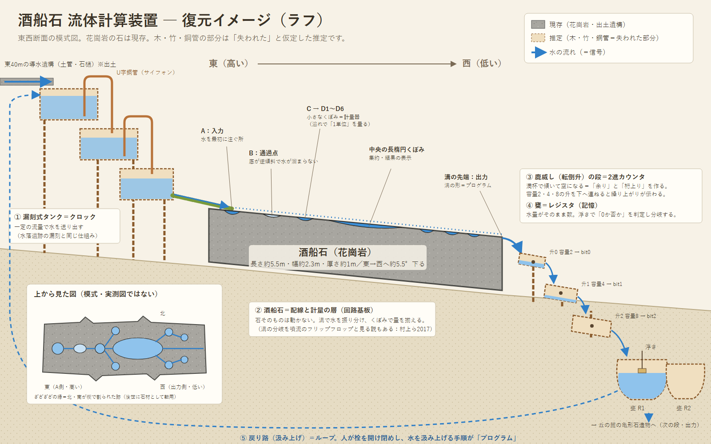

# Sakafune — 酒船石を「水の計算機」として読む

奈良県明日香村の **酒船石（さかふねいし）** を、流体で計算する装置（またはその一部）として読み解く思考実験と、飛鳥時代の技術で作れる「水のチューリング計算装置」の設計スケッチです。

> **注意**：これは考古学上の定説ではなく、仮説にもとづく思考実験です。確認された事実と推論は区別して書いています。

*復元イメージ（ラフ）。グレーの部分は現存または出土した遺構、点線の部分は失われたと仮定した推定です。左下の上面図は模式図で、実測図ではありません。*

## 参加するには

興味のある方なら、どなたでも歓迎します。AIと一緒に進めることを前提にしています。

1. **[HANDOFF.md](HANDOFF.md) を読む**（AIに読み込ませる）。プロジェクトの現在地、事実と仮説、次の課題がまとまっています。
2. AI向けの作業ルールは [AGENTS.md](AGENTS.md) にあります。Claude Code では `CLAUDE.md` から自動で読み込まれます。
3. 質問・反論・新しい資料は Issue へ、修正や追加は Pull Request でお願いします。

| ファイル | 内容 |
|---|---|
| [HANDOFF.md](HANDOFF.md) | 最新の引き継ぎ（プロジェクトの現在地） |
| [handoff/](handoff/) | 引き継ぎの過去の版（節目ごとのスナップショット） |
| [references/](references/README.md) | 分野別の文献リスト |
| [design/](design/) | 設計（設計01：教訓桝による最小の計算装置） |
| [images/](images/README.md) | 図・画像（作成者・作成AIの一覧つき） |

## 発想

- 流体がチューリング完全になりうることは、数学的にも（流体方程式の解に計算機を埋め込む研究）、工学的にも（水のタンクや気泡で論理回路を作る研究）示されつつあります。
- 酒船石の上面には、くぼみと、それらをつなぐ溝が彫られています。これを **配線と計量の層（回路基板）** と見なし、失われた木・竹・銅管の部分を補えば、水で計算する装置として成り立つのではないか、というのが出発点です。

## 確認されている事実

| 項目 | 内容 | 出典 |
|---|---|---|
| 石材・寸法 | 花崗岩。長さ約5.5m・幅約2.3m・厚さ約1.0m | [1][2] |
| 向き・傾斜 | 主軸はほぼ東西。東から西へ約5.5度傾く | [1] |
| 水の流れ | くぼみAに注ぐと B → C → D1〜D6 へ流れる | [1] |
| くぼみB | 底が逆向きに傾いていて、水が溜まらずに流れ下る | [1] |
| 欠損 | 北側・南側の一部が人為的に割り取られている（後世に石材として転用された説） | [1][2] |
| 周辺 | 丘の麓に亀形石造物を含む導水施設。石の東約40mに導水用の土管・石樋 | [1][2] |
| 近隣の技術 | 水落遺跡の漏刻（水時計）では、水槽の間をU字型の銅管（サイフォン）でつないでいる | [2] |

## 設計の考え方（スケッチ）

0と1の論理ゲートを水で作るより、**水の量そのものを数として扱う「カウンタ機械」** を目標にします。カウンタ2本と有限の制御があれば、チューリング完全になることが知られています（Minsky, 1967）。

| 役割 | 部品 | 仕組み |
|---|---|---|
| クロック | 漏刻式の多段タンク | 一定の流量で水を送り出す |
| 配線・計量 | 酒船石の溝とくぼみ | 溝で水を振り分け、くぼみから溢れさせて「1単位」に揃える |
| 加算・桁上り | 鹿威し（転倒升） | 容量2の升は「n mod 2」を残し、桁上りを次へ流す。容量2・4・8…と連ねると2進カウンタになる |
| 記憶 | 甕 | 水量がそのまま数になる。浮きで「0か否か」を判定して流れを分ける |
| ループ | 戻り路（汲み上げ） | 人が栓を開け閉めし、水を汲み上げる手順が「プログラム」になる |

## 先行研究

村上・窪田・望月（2017）は、酒船石の溝を **流体素子のフリップフロップ回路** に見立てています。縮尺模型の実験で、溝のつなぎ方を変えると流出量が変わることを確かめました。ただし、2つの状態を保持できること（双安定性）はまだ実証されていません。

## 今後の課題

- 縮尺模型で、注水量を増やすときと減らすときで振り分けが変わるか（双安定性）を確かめる
- 鹿威しによる2進カウンタの試作（ペットボトルなど）
- 素子のふるまいを離散的にモデル化したシミュレータ
- 実測図にもとづく、くぼみの配置と容積の確認

## 参考文献

分野別の詳しい文献リストは [references/](references/README.md) にあります（考古学・流体素子・数学・計算理論）。ここには主なものだけを挙げます。

1. 日本経済新聞（2014年7月11日）「石と水の都、面影が凝縮 「謎」の遺物 酒船石」 https://www.nikkei.com/article/DGXNASHC03023_U4A700C1AA1P00/
2. 村上優依・窪田佳寛・望月修（2017）「酒船石が流体素子であった可能性に関する考察」『ながれ』36, 417–420, 日本流体力学会 https://www.nagare.or.jp/download/noauth.html?d=36-6_tokushu13.pdf&dir=64
3. Minsky, M. (1967). *Computation: Finite and Infinite Machines*. Prentice-Hall.
4. Prakash, M. & Gershenfeld, N. (2007). Microfluidic Bubble Logic. *Science*, 315(5813), 832–835. DOI: 10.1126/science.1136907
5. Katsikis, G., Cybulski, J.S., & Prakash, M. (2015). Synchronous universal droplet logic and control. *Nature Physics*. DOI: 10.1038/nphys3341
6. Adamatzky, A. (2019). A brief history of liquid computers. *Phil. Trans. R. Soc. B*, 374(1774), 20180372. DOI: 10.1098/rstb.2018.0372
7. Cardona, R., Miranda, E., & Peralta-Salas, D. (2025). Towards a Fluid Computer. *Foundations of Computational Mathematics*, 25, 1921–1937. DOI: 10.1007/s10208-025-09699-6

## ライセンス

[MIT License](LICENSE)。引用した論文・記事の権利は、それぞれの著者・発行元に帰属します。
