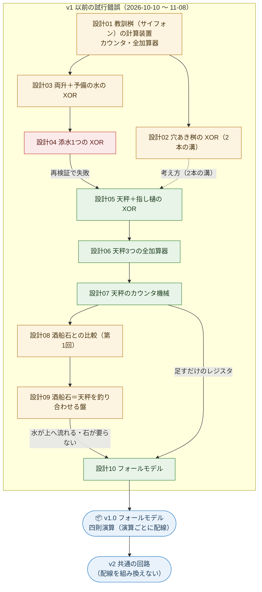

# バージョンと継代（試行錯誤の系譜）

- 作成：Claude Opus 5.5（`claude-opus-5-5`）、2026-11-08。方針：kuippa（ここまでを保存し、ここから ver1 でメジャーバージョンを振る。失敗した版も継代で見えるようにする）
- 状態の記号：✅ 採用（次の世代へ引き継いだ）／❌ 失敗・不採用／↩ 見直し（考え方は残し、形を変えた）／📦 保存（リリース）

---

## 1. バージョンの決まり

| 決まり | 内容 |
|---|---|
| メジャーバージョン | **装置の作り（アーキテクチャ）が変わるたびに 1 つ上げる**。v1, v2, … |
| 保存のしかた | リリースした版には git のタグ（`v1.0` など）を付ける。そのタグを取り出せば、その版がそのまま動く |
| 凍結 | リリースした版のファイルは、誤りの修正以外では書き換えない。次の版は**新しいファイル**に作る（前の版と並べて動かせる） |
| 設計の文書 | 番号を増やして足していく（design/01〜）。古い設計も消さない。失敗した設計は「なぜ失敗したか」を本文に残す |
| 継代の記録 | このファイルに、版ごとの「親（どこから来たか）」「引き継いだもの」「捨てたもの」を書く |

## 2. 系譜図

## 3. v1 以前の試行錯誤（継代）

| 設計 | 日付・コミット | 中身 | 結果 | 理由・引き継いだもの |
|---|---|---|---|---|
| [01](design/01_minimal-device.md) | 2026-10-10 `4b04296` `c1ce941` | 教訓桝（サイフォン）を積んだカウンタ、栓付きの教訓桝の全加算器 | ↩ | 人が栓を抜く手順（クロック）が要る。「人は電源とクロックだけ、判断は水」という基準はここで決めて、v1 まで引き継いだ |
| [02](design/02_holed-cup.md) | 2026-10-10 `4a63cfa` | 穴あき桝の XOR（1ビットを2本の溝で表す） | ↩ | 栓なしで XOR ができるが、出力の量が段ごとに減る。「穴・合流・分水だけでは XOR が作れない」という整理を残した |
| [03](design/03_toggle-reserve.md) | 2026-10-10 `8431d00` | 両升＋予備の水 c の XOR | ↩ | 両升の記録は1662年の英国が最古で、飛鳥の部品としては根拠が弱い。「毎回必ず来る予備の水（電源）」の考え方は v1 まで残った |
| [04](design/04_sozu-xor.md) | 2026-10-10 `002fcdc`、再検証 2026-11-07 `8ca4241` | 添水1つの XOR | ❌ | 少しずつ注ぐと、途中で傾いた残りの水が溜まり、注ぐ量が1%ずれただけで4通り中3通りを誤った（理想化した照合の OK は偶然）。**失敗の記録として本文 §6 に残した** |
| [05](design/05_balance-xor.md) | 2026-11-07 `8ca4241` | 天秤＋指し樋の XOR（数えずに比べる） | ✅ | 誤差に強い（±0.1u で 99.98%）。比較器（CMP）と振り分け器（RTE）として v1 の部品になった |
| [06](design/06_balance-full-adder.md) | 2026-11-07 `cb337a4` | 天秤3つの全加算器 | ✅ | 分水口で信号を配ると誤差に弱い（偏り±10%で78%）ことが分かり、「判定は振り分け器の数だけ写せる」を採用 |
| [07](design/07_counter-machine.md) | 2026-11-07 `f050ce7` | 天秤のカウンタ機械（Minsky） | ✅ | 「値＝＋升−−升、水は足すだけ」のレジスタ。v1 の REG そのもの。誤差が溜まる性質もここで分かった |
| [08](design/08_stone-comparison.md) | 2026-11-07 `e2eb5dc` | 酒船石との比較（第1回） | ↩ | 計算機の仮説だけを支持する特徴は見つからなかった。実測が要る |
| [09](design/09_sakafune-reconstruction.md) | 2026-11-07 `8e5ac9b` `f904366`、修正 11-08 `9e42801` | 酒船石＝天秤を釣り合わせる盤 | ↩ | 石の配置に合わせたため、水を上へ運ぶ必要が出た（A1 の水が指し樋へ上る、手番の水の輪）。kuippa の指摘「石が要らない作りになっている」で、石から切り離すことにした |
| [10](design/10_fall-model.md) | 2026-11-08 `f2b9b3a` 〜 `709d6f2` | フォールモデル（位置エネルギーだけ） | ✅ | v1 の本体 |

## 4. 📦 v1.0 ― フォールモデル（2026-11-08、タグ `v1.0`）

- **親**：設計10（フォールモデル）。設計05〜07 の天秤・振り分け器・足すだけのレジスタを引き継ぐ
- **中身**：
  - 部品の定義：[design/parts_catalog.md](design/parts_catalog.md)（基本部品10種、REG・OUT・PCR・DCD・駅、あふれ止め）
  - 設計：[design/10_fall-model.md](design/10_fall-model.md)
  - 計算の中身：`tools/viewer/fall_machine.js`、テスト：`node tools/viewer/test_fall.js`
  - 画面：`tools/viewer/fall.html`、模式図：`tools/viewer/diagram.html`
- **できること**：最初に水を置いたら、位置エネルギーだけで（水は上から下へだけ）四則演算をする。a, b = 0〜9 の全組み合わせで正しい。1 ÷ 0 はあふれ止めで異常停止
- **限界（v2 で解く）**：
  - **演算ごとに配線が違う**。足し算・引き算・掛け算・割り算で、駅の数も、どの駅からどのレジスタへ水路を引くかも変わる。演算を変えるには、装置を組み直す必要がある
  - 長い計算には ±1% の量り分け器が要る
- **v1 に含めないもの**：設計09 の酒船石の画面（`tools/viewer/arith.html`、`sakafune_machine.js`）は v1 以前の試行として残す。動くが、v1 の系統ではない

## 5. v2（開発中）― 共通の回路

- **親**：v1.0
- **目標**：四則演算で装置の配線を組み換えない。1つの固定した装置に、プログラム（どの命令をどの順に）を**水の置き方（データ）**として与えて動かす
- **決まり**：v1 のファイルは凍結。v2 は新しいファイル（設計11〜、`tools/viewer/` の新しいファイル）に作る
