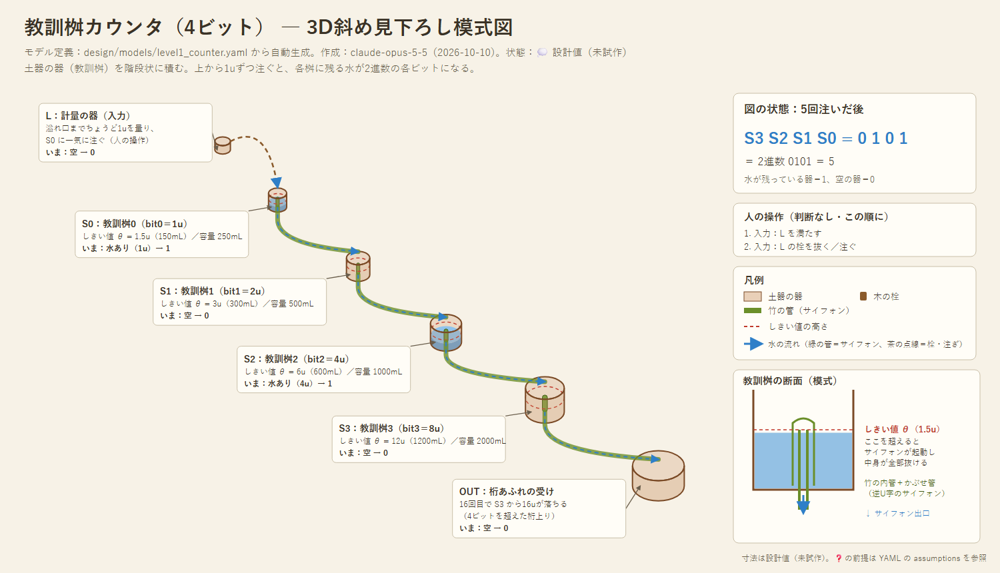
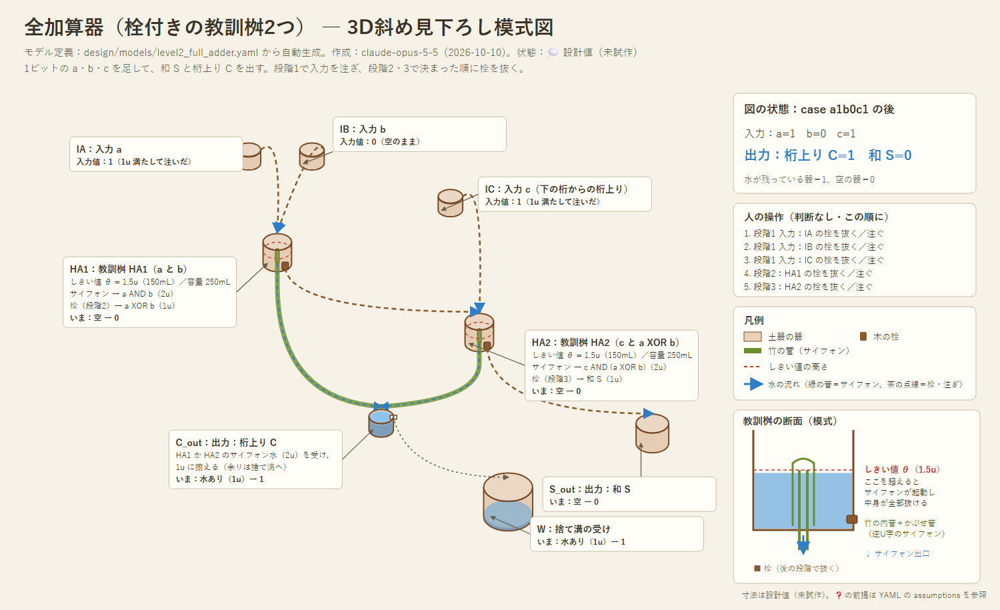

# 設計01：原始的な技術で作れる、いちばん単純な水の計算装置

- 作成：Claude Opus 5.5（`claude-opus-5-5`）、2026-10-10
- 状態：💭 設計スケッチ（試作・シミュレーションでの検証前）
- 前提：酒船石の構造からはいったん離れて設計する。酒船石との比較は最後の段階（M5）で行う

---

## 0. 「いちばん単純」の基準

| 基準 | 内容 |
|---|---|
| 部品の種類を最小にする | 中心になる部品は **1種類（教訓桝）** だけ。ほかは溝・分水口・栓・計量の器 |
| 原始的な技術で作れる | 土器・木・竹・石・重力だけ。可動部をできるだけ持たない |
| 判断は水がする | 人がしてよいのは「決まった手順の操作」だけ。**中身を見て判断・分岐しない** |

### 人の役割（判断なし）
電子回路にたとえると、人は「電源」と「クロック」の役で、論理は水が担います。

| 人がしてよいこと | 電子回路でいうと |
|---|---|
| 決まった器に、決まった線まで水を足す | 電源 |
| 決まった順番で栓を抜く | クロック（段階の切り替え） |
| 下の段に溜まった水を、決まった場所へ運び上げる | レジスタ間の転送・ループ |

- **人がしてはいけないこと**：水があるかどうかを見て、次の操作を変えること。これをすると、計算しているのは人になってしまいます。

---

## 1. 唯一の能動部品：教訓桝（きょうくんます）

ピタゴラスカップ（日本では「教訓茶碗」）と同じ仕組みの器を、計算用の部品として「教訓桝」と呼ぶことにします。

```
      ┃      ┃
      ┃ ┌┐   ┃   ← 内側の管（竹）の頂点の高さ＝しきい値 θ
      ┃ ││   ┃
      ┃~││~~~┃   ← 水位
      ┃ ││   ┃
      ┗━┷┷━━━┛
         ┃          ← サイフォン出口（底から下へ）
```

| 水の量 V | ふるまい |
|---|---|
| V < θ | そのまま溜まっている（**記憶**になる） |
| V ≥ θ | サイフォンが起動し、**中身が全部**出口から抜ける |

この1つの部品が、次の3つの役割を兼ねます。
1. **しきい値判定**：θ を超えたかどうか
2. **全部か無か**：出るときは全量。中途半端な量が残らないので、信号が揃う
3. **記憶**：しきい値に届かない水は溜まったまま残る

オプションとして、底に**栓**（抜くと残りの水が別の溝へ流れる）を付けます。

- 単位：水の量は「1単位（u）」で数えます。例えば 1u = 100mL。計量の器（溢れ口つきの器）で量ります。

---

## 2. レベル1：教訓桝カウンタ（いちばん単純な計算装置）⭐

**最初に作るのはこれ**です。教訓桝を縦に積むだけで、栓も人の判断も要りません。

### 構造
- モデル定義（正本）：[models/level1_counter.yaml](models/level1_counter.yaml)
- 3D斜め見下ろし図（YAMLから自動生成）：[images/level1-counter_iso_20261010_claude-opus-5-5.png](../images/level1-counter_iso_20261010_claude-opus-5-5.png)



```
注水（1uずつ）
   ▼
 [桝0 θ=1.5u] ── 抜けた水（2u）── ▶ [桝1 θ=3u] ── 抜けた水（4u）── ▶ [桝2 θ=6u] ── ▶ …
  残る水 0 or 1u                     残る水 0 or 2u                    残る水 0 or 4u
  ＝ bit0                            ＝ bit1                          ＝ bit2
```
- 桝 i のしきい値は 1.5 × 2^i u。桝 i に届く水は 2^i u ずつで、溜まるのは 0 か 2^i u のどちらか。
- 2回分届くと、しきい値を超えてサイフォンが起動し、2^(i+1) u が丸ごと次の桝へ落ちます。これが**桁上り**です。
- しきい値を2回分のちょうど中間に置いているので、量の誤差は**±0.5回分まで許容**できます。

### 動作例（3回注ぐ）
| 注いだ回数 | 桝0 | 桝1 | 読み（2進数） |
|---|---|---|---|
| 0 | 0 | 0 | 00 |
| 1 | 1u | 0 | 01 |
| 2 | 0（2u抜けて桝1へ） | 2u | 10 |
| 3 | 1u | 2u | 11 |

### できる計算
- **数える**：注いだ回数が2進数で表示されます。1進数から2進数への変換でもあります。
- **足し算**：b を足すときは、b の各ビットについて、桝 i に 2^i u を直接注ぎます（横から注ぐ口を付ける）。繰り上がりは自動で伝わります。**溜めておける加算器（アキュムレータ）**になります。

### 大きさの目安（1u = 100mL）
| ビット数 | 最後の桝のしきい値 | 最後の桝の容量 |
|---|---|---|
| 4 | 12u | 約1.2L |
| 6 | 48u | 約4.8L |
| 8 | 192u | 約19L |

桁が増えるほど、器が倍々で大きくなります。原始的な技術で現実的なのは4〜6ビットくらいです。

---

## 3. レベル2：教訓桝で論理ゲートを作る

栓を付けた教訓桝を使います。操作は2段階に分けます。
- **段階1（入力）**：入力の水を注ぐ。しきい値を超えた分は、サイフォンで自動的に出ていく。
- **段階2（排出）**：栓を抜く。残っていた水が、別の溝へ流れる。

### 3.1 半加算器：桝1つで AND と XOR
入力 x, y（それぞれ 0 か 1u）を、θ=1.5u の教訓桝に注ぎます。

| x | y | 段階1：サイフォン出口 | 段階2：栓の出口 |
|---|---|---|---|
| 0 | 0 | なし | なし |
| 1 | 0 | なし | 1u |
| 0 | 1 | なし | 1u |
| 1 | 1 | **2u**（全部抜ける） | なし |

- サイフォン出口 ＝ **AND**（桁上り）。2uが出るので、2本に分けられます（分岐数2）。
- 栓の出口 ＝ **XOR**（和）

### 3.1a 全加算器：栓付きの教訓桝2つ（モデル化・照合済み）
- モデル定義（正本）：[models/level2_full_adder.yaml](models/level2_full_adder.yaml)
- 3D斜め見下ろし図（YAMLから自動生成）：[images/level2-full-adder_iso_20261010_claude-opus-5-5.png](../images/level2-full-adder_iso_20261010_claude-opus-5-5.png)



| 器 | 受けるもの | サイフォン出口 | 栓の出口 |
|---|---|---|---|
| HA1 | a, b | a AND b → 桁上り C へ | a XOR b → HA2 へ（段階2） |
| HA2 | c, a XOR b | c AND (a XOR b) → 桁上り C へ | a XOR b XOR c → 和 S（段階3） |

- 桁上り C ＝ ab ＋ c(a XOR b)。2つのサイフォンは**同時には起きない**（ab=1 なら a XOR b=0）。そのため、2本を同じ計量の器で受けて 1u に揃えるだけでよく、**ORゲートが要らない**。
- 人の操作は5手（入力を3つ注ぐ → HA1の栓 → HA2の栓）。すべて判断なし。
- 入力8通りすべてで、期待される和と桁上りが出ることをシミュレーションで確認した。💭（論理の確認であり、物理的な確認ではない）
- 新しく出てきた前提（YAMLの B1〜B5）：栓が漏れないこと、a と b を続けて注いでも HA1 の中で合わさること、計量の器が 2u を受けても正確に 1u を残すこと、など。

### 3.2 増幅器・NOT：「下駄を履かせた」教訓桝
あらかじめ**下駄（バイアス）**として水を入れておくと、少しの入力で大量の水を流せます。電子回路のトランジスタにバイアスをかけるのと同じ考え方です。

| 部品 | 下駄 | θ | 入力1のとき | 入力0のとき |
|---|---|---|---|---|
| **増幅器** | 3u | 3.5u | 4u以上がサイフォンで出る（分けて3本にできる） | 何も出ない（下駄は残り、次も使える） |
| **NOT** | 1u | 1.5u | 2uがサイフォンで捨て溝へ。段階2では何も出ない → **0** | 段階2で栓から1u → **1** |

- 下駄を使ったら、人が「線まで水を足す」。これは判断なしの操作です。

### 3.3 これで何でも作れる
AND・XOR・NOT（と定数1）がそろうと、どんな論理関数も組めます（関数的完全性）。さらに増幅器があるので、1つの出力を複数のゲートへ分けられます。

### 3.4 信号を揃え直す：計量の器
溝で分けた水は量がばらつきます。そこで「溢れ口が1uの高さにある器」で受け、余分を捨て溝へ流して**ちょうど1u**に揃え直します。誤差がたまらないようにするための必須部品です。

---

## 4. レベル3：チューリング完全にする（スケッチ）

### 方針：ルール110の「1世代ぶんの板」＋人による汲み上げ
- **ルール110**は、1列に並んだセルが、自分と左右の状態だけで次の状態を決める、いちばん単純な規則の一つです。それでもチューリング完全であることが知られています（Cook 2004）。
- **すべてのセルが同じ形**なので、同じ部品を並べるだけで作れます。原始的な技術で作るのに向いています。

### ルール110の規則
左 p・自分 q・右 r から、次の自分の状態を決めます。

| pqr | 111 | 110 | 101 | 100 | 011 | 010 | 001 | 000 |
|---|---|---|---|---|---|---|---|---|
| 次 | 0 | 1 | 1 | 0 | 1 | 1 | 1 | 0 |

まとめると、**次 = (q XOR r) または (q AND r AND NOT p)** です。

### 1セルの回路（教訓桝3つ＋増幅器1つ）
```
 q,r ─▶ [A θ1.5u] ─サイフォン(qr:2u)─▶ [B θ2.5u] ◀─ p(1u)
           │栓（段階2）                    │サイフォン(p∧q∧r:3u) ─▶ 捨て溝
           ▼                              │栓（段階3）
        q XOR r (1u) ──┐                  ▼
                       │            [C θ1.5u]
                       │              │サイフォン(qr∧¬p:2u)
                       ▼              ▼     栓（段階4）─▶ 捨て溝（pだけのとき）
                   ［出力の溝］ ◀────┘
                       ▼
               [D 増幅器 下駄3u θ3.5u] ─▶ 3本に分ける ─▶ 計量の器（1u）×3
                                                  （次の世代の左・自分・右のセルへ）
```

### 動作の確認（8通りすべて）
| pqr | A：XOR／AND | B に入る量 | B のサイフォン | C に入る量 | C のサイフォン | 出力 | ルール110 |
|---|---|---|---|---|---|---|---|
| 000 | 0／0 | 0 | なし | 0 | なし | 0 | 0 ✓ |
| 001 | 1／0 | 0 | なし | 0 | なし | 1 | 1 ✓ |
| 010 | 1／0 | 0 | なし | 0 | なし | 1 | 1 ✓ |
| 011 | 0／2u | 2u | なし | 2u | 2u | 1 | 1 ✓ |
| 100 | 0／0 | 1u | なし | 1u | なし（捨て溝へ） | 0 | 0 ✓ |
| 101 | 1／0 | 1u | なし | 1u | なし（捨て溝へ） | 1 | 1 ✓ |
| 110 | 1／0 | 1u | なし | 1u | なし（捨て溝へ） | 1 | 1 ✓ |
| 111 | 0／2u | 3u | **3u捨て溝へ** | 0 | なし | 0 | 0 ✓ |

- 「q XOR r」と「qr∧¬p」は同時に1にならないので、同じ出力の溝に合流させてかまいません。

### 1世代の手順（すべて判断なし）
1. 増幅器Dに、下駄を線まで足す
2. 入力の計量の器の栓を抜く（p, q, r が A・B に入る）
3. 全セルのAの栓を抜く → 4. 全セルのBの栓を抜く → 5. 全セルのCの栓を抜く
6. 下の段に溜まった計量の器の水を、上の段の入力の器へ運ぶ（次の世代へ）

### チューリング完全性についての注意
- ルール110のチューリング完全性は、**周期的な背景パターンが無限に続く初期状態**を前提にしています。現実の装置では、セルの数を「必要になったら足す」形になります。どんな物理的な計算機も記憶は有限なので、これは普通のコンピュータと同じ意味での完全性です。
- 計算は遅いです。ただし、ルール110は「計算する」ことの証明には向いていても、実用には向きません。実用的な計算の実演には、レベル1・2（加算器など）を使います。

---

## 5. 物理的に成り立つかの課題（M3で確かめる）

| 課題 | 内容 |
|---|---|
| サイフォンの起動 | 水位がゆっくり上がると、サイフォンが起動せずにチョロチョロ漏れるだけになることがある。注ぐ速さと管の太さの関係を確かめる |
| 完全に抜けるか | サイフォンが途中で切れて水が残ったり、空気が噛んだりしないか |
| 逆流・漏れ | Steve Mould の試作で起きた、器の背面をつたう漏れ（いわゆるメモリリーク） |
| 残りの水 | 器の壁に付く水の膜や蒸発による誤差。計量の器で揃え直せる範囲か |
| 栓の密閉 | 木の栓・粘土の栓で、段階2まで漏れずに保てるか |
| 大きさ | 1uをいくらにすると、表面張力の影響が無視できて、かつ運べる量になるか |

---

## 6. 酒船石と比べるための「予測」（先に書いておく）

M5で酒船石と比べるときに、都合よく読まないように、**酒船石を見直す前に**「水の計算機ならこういう特徴が出るはず」を書いておきます。

1. 同じ容積の器（くぼみ）が繰り返し並ぶ。または容積が1:2:4…の比になっている
2. 器と器の間に段差がある（サイフォンや溢れで下の段へ落とすため）
3. 栓の穴・排水の穴がある
4. 「捨て溝」のような、計算に使わない水を逃がす経路がある
5. 同じ形の単位（セル）が繰り返し並ぶ
6. 運び上げ（ループ）のための、人が作業する場所や置き台がある

逆に、ただ水を分けて流すための施設（祭祀・庭園）なら、次のような特徴が予想されます。
- 器の容積に規則性がない
- 栓の穴がない
- 流れは一方通行で、見た目の対称性が重視される

---

## 7. 次の一手

1. **レベル1の試作**：ペットボトルとストローで、教訓桝を2〜3段積んだカウンタを作る（M3）
2. **シミュレータ**：教訓桝・栓・計量の器を離散的にモデル化し、レベル1〜3を動かす（M1・M2）
3. **作図**：レベル1・2の構造図

## 参考
- 教訓茶碗・サイフォンの計算：[references/02_fluidics.md](../references/02_fluidics.md)
- ルール110：Cook, M. (2004). Universality in Elementary Cellular Automata. *Complex Systems*, 15(1), 1–40. 📘
- カウンタ機械による別の方式：[HANDOFF.md](../HANDOFF.md) §5.3
