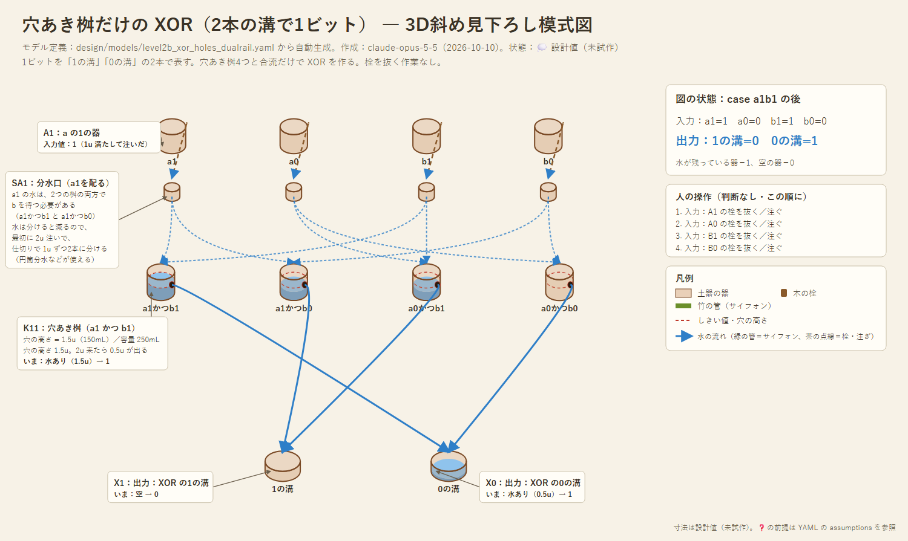

# 設計02：栓を抜かずに XOR を作る ― 穴あき桝・両升・2本の溝

- 作成：Claude Opus 5.5（`claude-opus-5-5`）、2026-10-10
- 状態：💭 設計スケッチ（試作前）。論理はシミュレーションで照合済み
- きっかけ：設計01のレベル2では、XOR を取り出すのに「栓を抜く」作業が要った。これを無くせないか

---

## 1. 結論

| 方法 | 1 XOR 1 = 0 | 栓・合図 | 部品 | 出力 |
|---|---|---|---|---|
| A. 栓付きの教訓桝（設計01） | ○ | 栓を抜く | 教訓桝 | 水（1u） |
| B. 両升（左右に升がある転倒升） | ○ | 不要（読むだけなら） | 両升 | **升の向き**（水で流すには読み出しの合図が要る） |
| **C. 穴あき桝＋2本の溝** | ○ | **不要** | 穴あき桝・分水口 | **水（0.5u）**がそのまま流れる |

---

## 2. 穴あき桝

器の側面の、高さ θ のところに穴をあけたもの。石や土器に穴を彫るだけで作れ、管も可動部も要らない。

| 入った量 n | 溜まる量 | 穴から出る量 |
|---|---|---|
| θ 以下 | n | 0 |
| θ より多い | θ | n − θ |

- 「頭打ち（min）」と「引き算（0 より下にはならない）」の2つを、1つの器でこなす。
- 水の量をそのまま数として扱えるので、0/1 に限らない計算に向く。例：カウンタ機械の「1減らす」は、穴の高さを 1u にした穴あき桝に通すだけでよい。穴から n−1 が出て、器に残る水（1u か 0）が「0 ではなかった」印になる。

### 穴だけでは XOR が作れない理由
穴あき桝の「溜まる量」も「出る量」も、入れる水を増やして**減ることはない**。合流・分水も同じ。だから、それらをいくらつないでも、全体として「入力を増やすと出力が減る」ふるまいは作れない。XOR（1つなら出て、2つなら出ない）と NOT はこのふるまいを必要とするので、**1本の溝で1ビットを表す限り、穴だけでは作れない**。

この性質を壊せるのは、教訓桝（増やすと全部抜けて 0 になる）や両升（2回目で元に戻る）のような「全部出す」「元に戻る」部品だけ。

---

## 3. 解決：1ビットを2本の溝で表す（デュアルレール）

1ビットを「1の溝」と「0の溝」の2本で表す。**必ずどちらか一方だけに水が来る**。
- NOT は、2本の溝を入れ替えるだけ（部品が要らない）
- XOR の 1 ＝ (a1 かつ b0) または (a0 かつ b1)
- XOR の 0 ＝ (a1 かつ b1) または (a0 かつ b0)

「かつ」は穴あき桝1つ（2本来たときだけ穴から出る）、「または」は溝の合流。どれも「増やすと増える」部品なので、穴だけで作れる。

### モデル
- モデル定義（正本）：[models/level2b_xor_holes_dualrail.yaml](models/level2b_xor_holes_dualrail.yaml)
- 3D斜め見下ろし図（自動生成）：

| 部品 | 数 | 役割 |
|---|---|---|
| 入力の器 | 4 | a1・a0・b1・b0。人が、a と b それぞれ一方だけを 2u 満たす（データの入力） |
| 分水口 | 4 | 2u を 1u ずつ、2つの穴あき桝へ（下の「分水口の役目」） |
| 穴あき桝（穴 1.5u） | 4 | 2本来たときだけ 0.5u が穴から出る |
| 出力の器 | 2 | XOR の1の溝・0の溝 |

- 人の操作は、入力の器を注ぐだけ（4手）。**栓も、時間合わせも要らない。**
- 4通りすべてで、正しい溝に水が出ることをシミュレーションで確認した（例：a=1, b=1 → 0の溝に 0.5u）。

### 分水口の役目
- **なぜ配るのか**：「a が 1」という情報は、「a1 かつ b1」と「a1 かつ b0」の**両方の桝**に要る。b がどちらになるかは a の側からは分からないので、両方の桝に a1 の水を 1u ずつ置いて、b を待たせる。b が来た方の桝だけが 2u になり、穴から溢れる。
- **なぜ 2u なのか**：電気の信号は線を枝分かれさせても同じ強さで届くが、水は分けると量が減る。だから最初に 2 倍（2u）注いで、半分ずつにする。
- **どう分けるか**：日本の用水で使われてきた水分けの仕掛けが使える。
  - 円筒分水：筒の中で水を下から湧き上がらせ、一周する縁から均等に溢れさせる。縁を区切る弧の長さの比で分ける。流れる量が変わっても割合が変わりにくい（例：川崎の久地円筒分水）📘
  - 石の仕切りで分ける分水（例：山梨県北杜市の三分一湧水）📘
  - 本プロジェクトでは、これらの事例の出典はまだ確認していない。

### 穴の高さ：1.5u と 1u の違い
| 穴の高さ | 2本来たとき出る量 | 1本だけのときの誤差の許容 |
|---|---|---|
| 1u | 1u | ほぼ 0（1本が少し多いだけで漏れる） |
| **1.5u** | 0.5u | ±0.5u（1本が 1.5u までなら漏れない） |

1.5u にすると誤差に強くなる代わりに、出力が半分になる。

---

## 4. 残る課題

1. **出力がだんだん小さくなる**：穴は水を減らすことしかできない（増幅できない）。段を重ねるたびに量が減るので、何段もつなぐには、量を戻す仕組みが要る。
   - 下駄を履かせた教訓桝（設計01 §3.2）で増幅する
   - 人が新しい水を注ぎ直す（「電源」の役）
   - 最初から入力を大きな量にしておく
2. **使わなかった水が器に残る**：穴より下の水は溜まったままなので、計算のたびに空にする（リセット）。
3. **分水口の精度**：2u を正確に半分にできるか。❓ 円筒分水のような、縁から均等に溢れさせる方式が有力。
4. **部品が増える**：XOR 1つに穴あき桝4つ。代わりに栓の操作と時間合わせが要らない。

---

## 5. 別案：両升（転倒升）

左右に升が付いた転倒升（雨量計で使われる仕組み。出典未確認 ❓）は、1u 入るたびに傾いて左右が入れ替わる。
- **向き**＝注いだ回数の偶奇＝ XOR（1 XOR 1 で元の向きに戻る）
- **右の升から出る水**＝ 2回ごとに 1u ＝ 桁上り
- a・b・c を同じ注ぎ口に入れれば、**両升1つで全加算器**になる。注ぐ順番も問わない
- 同じ大きさの両升を並べれば、何桁の足し算もできる（設計01 レベル1のように器を倍々にしなくてよい）
- 弱点：答えが水ではなく**升の向き**に残る。次の回路へ水として流すには、読み出し用の水を注いで、向きで振り分ける

今後、`tipping_bucket` としてモデル化する候補。

---

## 6. 酒船石との比較のためのメモ（予測、設計01 §6 に追加）

- 穴あき桝は、**石に彫りやすい**（管も栓も要らない）。水の計算機を石で作るなら、側面の穴や切り欠き（溢れ口）が、決まった高さに並ぶはず。
- 2本の溝で1ビットを表す方式なら、**溝が対になって並ぶ**はず。
- 穴の高さ（＝しきい値）が、器ごとに揃っているか、規則的な比になっているか。
