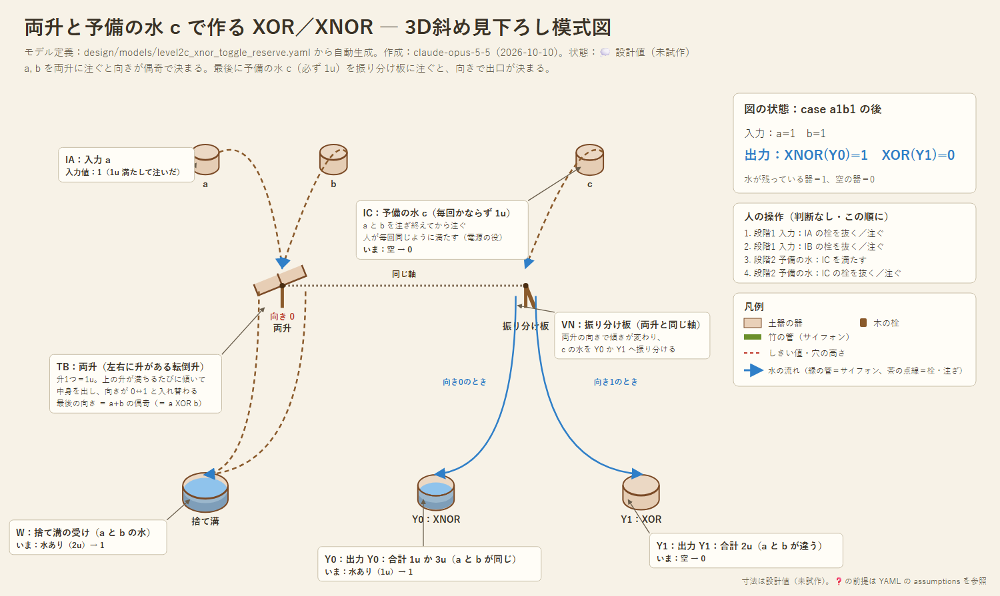

# 設計03：予備の水 c と両升で作る XOR／XNOR

- 作成：Claude Opus 5.5（`claude-opus-5-5`）、2026-10-10。発想：kuippa（予備の水 c を足して、合計 2u のときだけ捨てる）
- 状態：💭 設計スケッチ（試作前）。論理はシミュレーションで照合済み
- 関連：[設計01](01_minimal-device.md)（栓付きの教訓桝）、[設計02](02_holed-cup.md)（穴あき桝＋2本の溝、両升）

---

## 1. 発想

0 XOR 0 のときは、a からも b からも水が来ない。水が「来ない」ことは、待っていても分からない（いつまで待てばよいか決められない）。

そこで、**a・b とは別に、毎回かならず 1u 来る予備の水 c** を用意する。
- 合計 a+b+c が **1u か 3u**（a と b が同じ）→ c を**出力**へ
- 合計 a+b+c が **2u**（a と b が違う）→ c を**別の溝**へ

どの場合も c の水が必ずどちらかに出るので、「来ない」ことを待たなくてよい。出口が2つなので、結果は「XNOR の溝」と「XOR の溝」の2本に分かれて出る（設計02の「2本の溝で1ビット」と同じ形になる）。

## 2. 仕組み：両升を「2u で切り替わるスイッチ」にする

**両升**（左右に升がある転倒升）は、上を向いた升に 1u 入るたびに傾いて中身を出し、反対側の升が上に来る。向きは 0 → 1 → 0 → … と入れ替わる。
- a と b を両升に注ぐと、最後の向きは **a+b の偶奇**になる（0u・2u なら向き0、1u なら向き1）。a, b の水そのものは、傾いたときに捨て溝へ出る。
- 両升と**同じ軸**に**振り分け板**を付けておく。両升の向きに合わせて、板が左右どちらかに倒れる。
- 最後に c を振り分け板に注ぐ。向き0なら Y0（XNOR）へ、向き1なら Y1（XOR）へ流れる。

| a | b | a+b+c | 両升の向き | c の行き先 |
|---|---|---|---|---|
| 0 | 0 | 1u | 0 | **Y0**（XNOR＝1） |
| 1 | 0 | 2u | 1 | **Y1**（XOR＝1） |
| 0 | 1 | 2u | 1 | **Y1**（XOR＝1） |
| 1 | 1 | 3u | 0 | **Y0**（XNOR＝1） |

### モデル
- モデル定義（正本）：[models/level2c_xnor_toggle_reserve.yaml](models/level2c_xnor_toggle_reserve.yaml)
- 4通りすべてで、c が正しい出口に出ることをシミュレーションで確認した。

## 3. この方式のよいところ

| 点 | 内容 |
|---|---|
| 栓が要らない | 人の操作は「a, b を注ぐ → c を満たして注ぐ」だけ。判断なし |
| 量が減らない | 出力は c の新しい 1u。何段つないでも量が減らない（設計02の穴あき桝は 0.5u に減った） |
| 2本の溝で出る | XOR と XNOR が両方出る。次の回路で NOT が要るときは、溝を入れ替えるだけ |
| 部品が少ない | 両升1つ＋振り分け板1枚 |
| c は「電源」 | 毎回決まった量を足すだけなので、人が判断せずに担える。電子回路の電源と同じ役目 |

## 4. 前提と課題

- **c は a, b の後に注ぐ**（人の操作の順番。判断は要らない）。 💭
- 両升が 1u で確実に傾き、出し切って、反対側で止まるか。 ❓
- 振り分け板が両升と一緒に確実に倒れるか。 ❓
- a と b を続けて注いだとき、傾いている途中にこぼれて数え間違えないか（1u ずつ間を空ければ避けられる見込み）。 ❓
- 計算の後、両升を向き0に戻すか、向きを次の計算の初めの状態として記録しておく。

## 5. 別のやり方との比較

- **c も同じ両升に注ぐ場合**：最後に傾くのは c の 1u で、その水は「a と b が同じなら左、違えば右」から出る。ただし a, b の水も同じ左右の出口から出るので、c の水だけを分けるには別の仕掛けが要る。振り分け板を使う方が単純。
- **単純な鹿威し（2u で傾く）を使う場合**：2u のときだけ傾くので「a と b が両方 1」は分かるが、1u のときと 0u のときを区別できない。偶奇を数える両升なら、1u で切り替わり、2u で元に戻るので、XOR がそのまま向きになる。
- **設計02（穴あき桝＋2本の溝）との比較**：設計02は可動部がなく石に彫れるが、出力が減る。設計03は可動部（軸）があるが、出力が減らない。

## 6. 次の一手

- 両升を並べた多ビットの加算器（設計02 §5）と組み合わせる。和のビットを、この方式で c の水として読み出せる。
- 試作：両升はペットボトルを半分に切って、竹串を軸にすれば作れそう。振り分け板を同じ軸に付ける。
