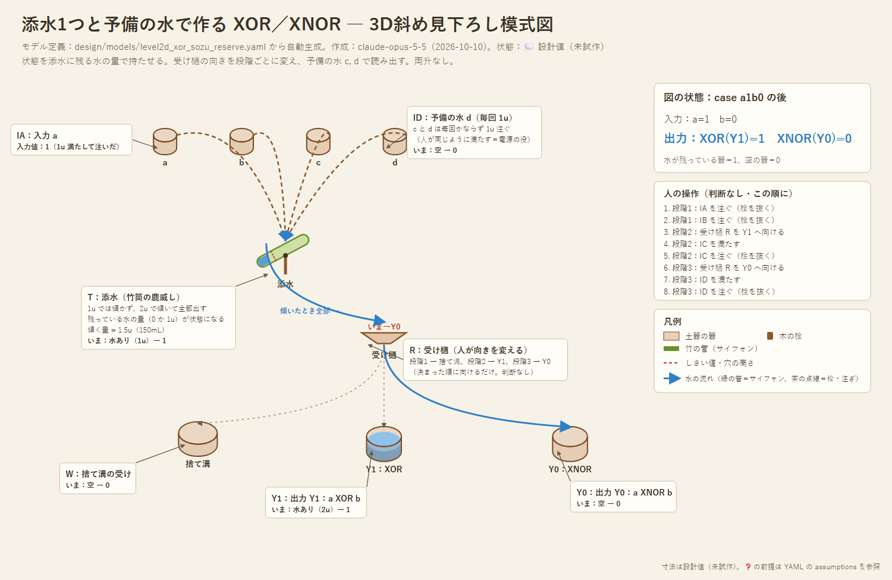

# 設計04：添水（鹿威し）1つで作る XOR／XNOR

- 作成：Claude Opus 5.5（`claude-opus-5-5`）、2026-10-10。発想：kuippa（両升を使わず、鹿威しくらいのスイッチで。手順は増えてよい）
- 状態：💭 設計スケッチ（試作前）。論理はシミュレーションで照合済み
- 関連：[設計03](03_toggle-reserve.md)（両升＋予備の水 c）。両升は記録上の最古が1662年の英国で、飛鳥時代の部品としては根拠が乏しい（[references/05](../references/05_traditional_water_tech.md)）

---

## 1. 考え方

**添水は、教訓桝（サイフォン桝）と同じ働きを管なしでこなす。** 竹筒に決まった量が溜まると傾いて全部出し、空になって元に戻る。

そこで、状態を「添水の**向き**」（両升のやり方）ではなく、「添水に**残っている水の量**」（0 か 1u）で持たせる。そのうえで、受け樋の向きを段階ごとに変えながら、予備の水を注いで読み出す。

## 2. 手順（人の操作はすべて判断なし）

| 段階 | 操作 | a+b が偶数（0 か 2） | a+b が奇数（1） |
|---|---|---|---|
| 1 | 受け樋は捨て溝へ。a, b を添水に注ぐ | 0 なら空のまま。2 なら傾いて捨て溝へ → 残り 0 | 残り 1u |
| 2 | 受け樋を **Y1** へ向け、予備の水 c（1u）を注ぐ | 1u 溜まる（傾かない） | 合計 2u で傾く → **Y1 に 2u** |
| 3 | 受け樋を **Y0** へ向け、予備の水 d（1u）を注ぐ | 合計 2u で傾く → **Y0 に 2u** | 1u 溜まる（傾かない） |

- 段階2の後、添水に残る水は「偶奇の反対」になる。これを段階3で読み出す。
- 結果：**Y1 に水 ＝ a XOR b**、**Y0 に水 ＝ a XNOR b**。必ずどちらか一方に 2u 出る。
- 4通りすべてで、正しい出口に出ることをシミュレーションで確認した。

### モデル
- モデル定義（正本）：[models/level2d_xor_sozu_reserve.yaml](models/level2d_xor_sozu_reserve.yaml)

## 3. 設計03（両升）との比較

| 点 | 設計03（両升＋振り分け板） | 設計04（添水＋受け樋） |
|---|---|---|
| 可動部 | 両升（左右に升、支点）＋同じ軸の振り分け板 | 添水（竹筒1本、支点）＋人が向きを変える受け樋 |
| 時代の根拠 | 両升は1662年の英国が最古の記録 | 添水・ばったりは農具として広く使われた（🔍） |
| 人の操作 | 3手（a, b, c） | 8手（a, b、樋を向ける、c、樋を向ける、d） |
| 予備の水 | c の 1回 | c と d の 2回 |
| 出力 | 1u | **2u**（2本に分けて次の2つの回路へ配れる） |

手順は増えるが、部品はより原始的になり、出力の量も増える。

## 4. 前提と課題

- **途中で傾く問題**（いちばん大きな課題）：添水は 1.5u を超えた瞬間に傾く。1u を注いでいる途中で傾くと、残りが空になった添水に溜まり、次の段階で数え間違える。対策の候補：
  - 計量の器の口を大きくして、1u を一気に落とす（傾く前に注ぎ切る）
  - 傾く量を 2u に近づける（ただし 1u と 2u の区別の余裕が減る）
  - 竹筒の口を、傾いている間も注がれた水が筒の中を通って出ていく形にする（鹿威しは傾いている間、入ってきた水を素通りさせる）
- 添水が毎回確実に全部出し切って戻るか。 ❓
- 受け樋を、人が決まった順に向けること。中身を見て決めるわけではないので、判断には当たらない。

## 5. サイフォンを使えたかについて（kuippa のコメント）

記録に残っていなくても、竹の水鉄砲や藁のストローで「水が勝手に外へ出ていく」現象は、昔の人も目にしていたはずで、それを利用した人がいても不思議ではない。💭

本プロジェクトでは、
- 「サイフォンは飛鳥時代にもありえた」を**推論（💭）**として扱う
- ただし設計では、**記録で裏付けられる部品（添水など）で代わりが利くなら、そちらを優先**する

という方針にする。
