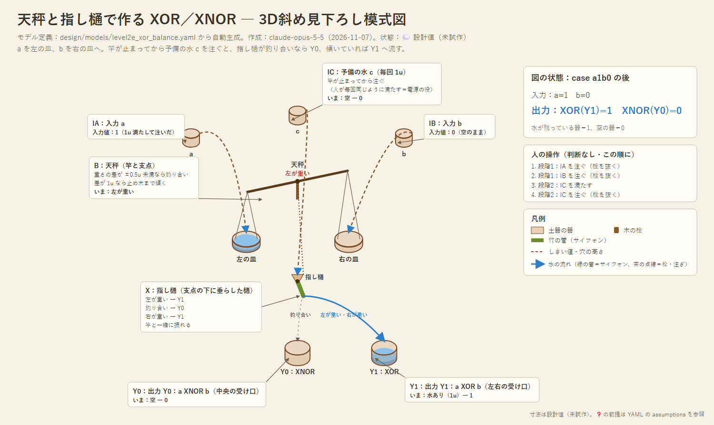

# 設計05：天秤と指し樋で作る XOR／XNOR（採用）

- 作成：Claude Opus 5.5（`claude-opus-5-5`）、2026-11-07。採用：kuippa（「技術的にプリミティブで壊れにくい」）
- 状態：💭 設計スケッチ（試作前）。XOR の**本命**として採用。工夫の余地は残っている
- 関連：設計02〜04（しきい値で数える方式）。設計04は再検証で弱点が見つかった（[04](04_sozu-xor.md) §6）。全加算器への組み上げは [設計06](06_balance-full-adder.md)
- モデル定義（正本）：[models/level2e_xor_balance.yaml](models/level2e_xor_balance.yaml)



---

## 1. 発想：数えずに「比べる」

設計01〜04は、どれも「溜めて、しきい値を超えたら出す」で XOR を作ろうとしていた。XOR が難しくなるのは、この発想で「1つなら出し、2つなら出さない」を作るから。

XOR は「**a と b が等しくない**」と言い換えられる。等しいかどうかは、数えなくても**天秤で比べれば**分かる。

## 2. 仕組み

```
        c（予備の水 1u）を、支点の上の漏斗から注ぐ
                 ▼
   ┌───────────●───────────┐  ← 竿。支点の下に垂らした「指し樋」が竿の傾きと一緒に振れる
   │                        │
  [皿 L]                  [皿 R]   ← 吊り皿：a を左、b を右に注ぐ
                 ┃ 指し樋
        ┌───┬───┬───┐
        │Y1 │Y0 │Y1 │   ← 受け口が3つ。釣り合えば中央、傾けば左右へ
        └───┴───┴───┘
```

| a | b | 竿 | c の行き先 |
|---|---|---|---|
| 0 | 0 | 水平 | 中央 → **Y0（XNOR）** |
| 1 | 0 | 左に傾く | 左 → **Y1（XOR）** |
| 0 | 1 | 右に傾く | 右 → **Y1（XOR）** |
| 1 | 1 | 水平 | 中央 → **Y0（XNOR）** |

人の操作：a を左の皿へ、b を右の皿へ注ぐ → 竿が止まるのを待つ → c を漏斗に注ぐ。判断は要らない。

## 3. よいところ

| 点 | 内容 |
|---|---|
| 途中で傾く問題がない | 天秤は最終的な重さの差で止まる。注ぐ順番や速さに左右されない（設計04の弱点が起きない） |
| 誤差に強い | 下の表のとおり |
| 出力がちょうど 1u | c の水そのもの。次の天秤の皿に、そのまま入力として注げる（分けたり増やしたりしなくてよい） |
| 時代考証 | 天秤（権衡）は、升と並ぶ度量衡の基本の道具。竿・吊り皿・竹の樋だけで作れる |
| ほかにも使える | 「どちらが重いか」で、カウンタ機械の「0 かどうか」の判定にも使える（片方の皿を空にしておく） |

## 4. 誤差に対する強さ（シミュレーション）

[tools/xor_robustness.py](../tools/xor_robustness.py) で、注ぐ量のばらつき（標準偏差）と、左右の皿の重さの狂いを入れて試した（各5000回×4通り）。

| 中央の受け口の半幅 | 注ぐ量のばらつき | 皿の狂い | 正答率 |
|---|---|---|---|
| 0.5u | ±0.03u | 0 / 0.2u | 100% / 100% |
| 0.5u | ±0.1u | 0 / 0.2u | 99.98% / 99.58% |
| 0.5u | ±0.2u | 0 / 0.2u | 97.82% / 94.42% |
| 0.3u | ±0.1u | 0 / 0.2u | 99.19% / 93.76% |

- 中央の受け口は広め（重さの差 ±0.5u 相当で中央に入る幅）がよい。
- 比較：設計04（添水、傾く量1.5u）はばらつき±0.03uでも 64%。教訓桝に替えれば 100%。

## 5. 竿の動きの計算（2026-11-07、テスト段階）

[tools/balance_dynamics.py](../tools/balance_dynamics.py) で、竿1本の回転を計算した（外部ライブラリなし。水の流れは計算せず、皿に増える重さと落ちる勢いだけを入れる）。寸法は仮の値で、ハンガーと紙コップくらいの大きさ。

- **仮の寸法**：腕 15cm、支点の下 7.3cm に重り 500g（指し樋を兼ねる）、指し樋 10cm、中央の受け口の半幅 2cm、止め木 ±25°。重りの深さは「重さの差 0.5u で、指し樋の先がちょうど中央の受け口の縁に来る」ように決めた。揺れの周期は約0.8秒。
- **止まる角度**：重さの差 0.4u で 9°（中央）、0.6u で 14°（左右）、1u で 22°（左右）。設計どおりに分かれる。
- **待ち時間**：a, b を注ぎ終えてから c を注ぐまでに、どれだけ待てば4通りすべて正しくなるか。
  - ゆっくり注ぐ（1u を2秒）と、揺れ止めがなくても待たずに済む。竿が注ぐ速さについてくるため。
  - 一気に注ぐ（1u を0.3秒）と揺れる。必要な待ち時間は、減衰比 0.02 で7.5秒、0.1 で1.3秒、0.3 で0.5秒、0.7 以上なら0秒。→ **「ゆっくり注ぐ」を手順にするか、皿の下に水を張って揺れを止める**。
- **指し樋を流れる c の重さ**：c を1秒に1kg（樋の中に最大1kg）流しても、指し樋の先のずれは 3.8cm → 2.1cm で、中央の縁（2cm）の外にとどまった。ふつうの速さ（50g/秒）なら 3.7cm で、影響はほとんどない。
- **重りの深さが大事**：深くしすぎる（2倍）と差 1u でも中央に入り、XOR にならない。浅くする（半分）と ±0.25u までしか中央に入らず、誤差に弱くなる。重りの深さで「中央に入る幅」が決まるので、**組み立て後に重りの位置で調整する**。
- 揺れの止まり方（減衰比）は仮の値。実物で「揺れが何秒で止まるか」を1回測れば当てはめられる。
- 画面で動きを見るビューア：`node tools/viewer/serve.js` → http://localhost:8765/ 。同じ式を JS に移したもの（外部パッケージなし）。条件をスライダーで変え、a, b, c を注ぐボタンと「4通りを実行」で確かめられる。判定は「c の水が実際に入った受け口」で行うので、指し樋の向きで判定する Python 版より待ち時間が少し短く出る（一気に注ぐ・減衰比0.1で 1.0秒 対 1.25秒）

## 6. 課題と工夫の余地（❓）

- 竿の揺れが止まるまでの時間。揺れを抑える工夫（皿の下に水を張った受けを置いて抵抗にする、など）。
- 竿が「水平」で止まるように、重心を支点より少し下に置く。差が 1u のときは、止め木に当たるまで大きく傾くようにする。
- 吊り皿の重さを左右で揃える（升の検査と同じように、基準のおもりで合わせる）。
- 皿に残った水は計算のたびに捨てる（リセット）。
- 3つ以上の XOR（全加算器の和）は、天秤をつなげて作る：XOR(XOR(a, b), c)。→ [設計06](06_balance-full-adder.md) で実施
- 指し樋を流れる c の重さは、竿の傾きを戻す向きに働く（傾くと樋の先が支点の真下からずれるため）。樋を短くし、細く流す。

## 7. 記録しておく別案

- **衝突ゲート**：2本の竹の注ぎ口から水を飛ばし、空中で交わるように向ける。片方だけなら交点を通り過ぎて反対側へ（XOR）、両方ならぶつかって真ん中へ落ちる（AND）。可動部がなく石に彫れる可能性があるが、同時に流す必要があり、しぶきの行き先は実験しないと分からない。
- 見送った案：水車の歯止め（高度すぎる）、満ちると沈む椀（AND しか作れない）、漏れの速さによる時間合わせ（不安定）。
