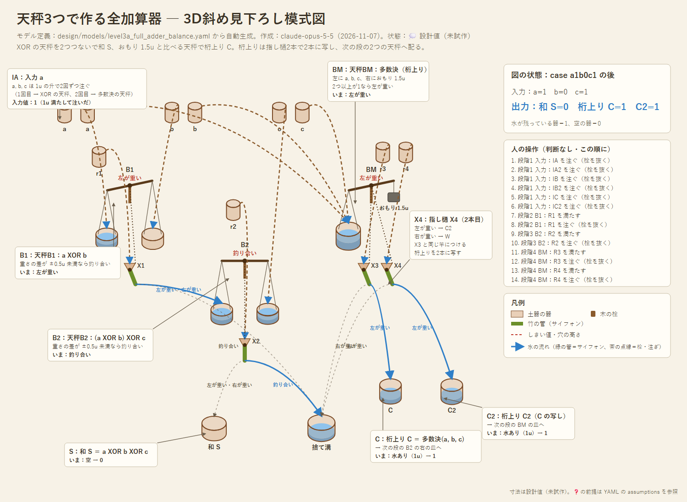

# 設計06：天秤だけで作る全加算器と多ビット加算器

- 作成：Claude Opus 5.5（`claude-opus-5-5`）、2026-11-07。方針：kuippa（天秤を採用部品にして全加算器へ進む）
- 状態：💭 設計スケッチ（試作前）。論理はシミュレーションで照合済み（8通り）。誤差試験は4ビット加算で実施
- 関連：[設計05](05_balance-xor.md)（天秤＋指し樋の XOR）。モデル定義：[models/level3a_full_adder_balance.yaml](models/level3a_full_adder_balance.yaml)、天秤 XOR 単体：[models/level2e_xor_balance.yaml](models/level2e_xor_balance.yaml)

---

## 1. 構成：天秤3つ

| 天秤 | 左の皿 | 右の皿 | 指し樋の受け口 | 役割 |
|---|---|---|---|---|
| B1 | a | b | 傾き → B2 の左の皿、釣り合い → 捨て溝 | a XOR b |
| B2 | B1 の出力 | c（下の桁からの桁上り） | 傾き → 和 S、釣り合い → 捨て溝 | **S ＝ a XOR b XOR c** |
| BM | a, b, c を全部 | おもり 1.5u | 左が重い → 桁上り C、右が重い → 捨て溝 | **C ＝ 多数決(a, b, c)** |

- 多数決の天秤は「2つ以上が1か」を、おもり 1.5u と比べて判定する。重さの差は ±0.5u か ±1.5u にしかならず、釣り合うことがないので、受け口は左右の2つでよい。
- 部品の種類は **天秤（＋指し樋）と升だけ**。教訓桝も添水も使わない。
- 出力はどれも予備の水そのもの（ちょうど 1u）なので、次の天秤の皿にそのまま注げる。

## 2. 人の操作（判断なし）

1. 入力を注ぐ：a, b, c を、それぞれ 1u の升で2回ずつ注ぐ（1回目は XOR の天秤へ、2回目は多数決の天秤へ）
2. B1 の竿が止まったら、予備の水 r1 を注ぐ
3. B2 の竿が止まったら、予備の水 r2 を注ぐ → 和 S
4. BM の竿が止まったら、予備の水 r3, r4 を注ぐ → 桁上り C, C2

段階4は段階1の後ならいつでもよい。段階3は段階2の後（B1 の出力が B2 の皿に入ってから）。

## 3. 1つの信号を2か所へ配る（ファンアウト）

a, b, c は、XOR の天秤と多数決の天秤の両方で使う。配り方を2通り比べた。

| 配り方 | 方法 | 弱点 |
|---|---|---|
| 分水口 | 2u 注いで、分水口で 1u ずつに分ける | 分水の偏りが、そのまま皿の重さの差になる |
| **升で2回・指し樋2本**（採用） | 入力は 1u の升で2回注ぐ。回路の中の信号（桁上り）は、**同じ竿に指し樋を2本つけ、予備の水を1本ずつ注ぐ** | 予備の水を注ぐ手間が増える |

**天秤の判定は、指し樋の数だけ写せる。** 竿の傾きは、予備の水を注いでも変わらない。そのため、同じ判定から、毎回きっちり量った 1u を何本でも取り出せる。これは電子回路の「増幅（ファンアウト）」にあたる。水の量の誤差は、天秤を1段通るごとに升の精度へ戻る。

## 4. 誤差に対する強さ（シミュレーション）

[tools/adder_robustness.py](../tools/adder_robustness.py) で、**4ビットの加算**（16×16＝256通り、天秤12個）を、誤差を入れて40回ずつ試した。数字は、答えが全桁合っていた割合。

| 注ぐ量のばらつき | 升で2回・指し樋2本（採用） | 分水口（偏り±5%） | 分水口（偏り±10%） |
|---|---|---|---|
| ±0.03u | 100% | 99.9% | 85.8% |
| ±0.1u | **99.94%** | 97.8% | 78.7% |
| ±0.1u、皿の狂い±0.2u | 99.1% | 94.0% | 71.5% |
| ±0.2u | 81.9% | 76.1% | 58.3% |

- 採用案は、おもりが±5%狂っても ±0.1u で 99.89%。
- 注ぐ量のばらつきが ±0.2u（升の2割）になると崩れる。升で量る精度は ±0.1u（1割）以内が目安。

## 5. 別案：目盛り天秤1つで全加算器（記録）

左の皿に a, b, c を全部、右におもり 1.5u を置く。重さの差は −1.5, −0.5, +0.5, +1.5u の4通り。竿の傾きが重さの差に**比例する**天秤（重心を低くした、目盛りを読む天秤）なら、指し樋2本で和と桁上りを同時に読める。

- 和の指し樋：受け口4つ（左から 0, 1, 0, 1）
- 桁上りの指し樋：受け口2つ

天秤が1ビットに1つで済み、ファンアウトも要らない（a, b, c は1回ずつ注げばよい）。誤差試験の正答率は、比例が±10%ずれても ±0.1u で 99.6%。採用案とほぼ同じになる。

ただし、「竿が途中の角度で止まり、その角度が重さの差に比例する」ことが前提になる。採用案の天秤は「釣り合いか、止め木まで傾くか」しか読まないので、作るのも調整するのも易しい。そのため採用案を本命にし、こちらは試作で竿のふるまいが分かってから再検討する。 💭

## 6. 課題（❓）

- 天秤の前提（揺れが止まるまでの時間、重心、指し樋を流れる水の重さ）は [level2e の assumptions](models/level2e_xor_balance.yaml) を参照。
- 同じ竿に指し樋を2本つける構造。2本の受け口が混ざらないように、前後にずらして置く。
- おもり 1.5u の作り方：升で量った水と石の分銅を天秤で釣り合わせる（度量衡の検査と同じ手順）。
- 4ビットで天秤12個、予備の水を1ビットあたり4回注ぐ。大きな計算には天秤の使い回し（リセットして次の桁に使う）を考える。
- 多ビット加算器の YAML 化（今はスクリプトでのみ確認）。
