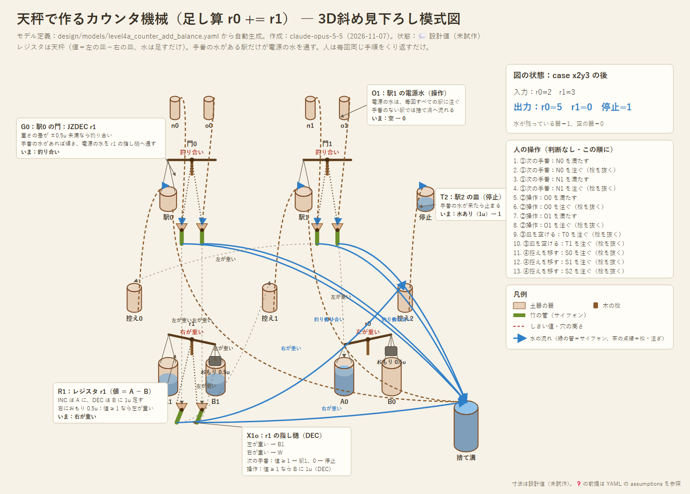

# 設計07：天秤で作るカウンタ機械（チューリング完全への道筋）

- 作成：Claude Opus 5.5（`claude-opus-5-5`）、2026-11-07
- 状態：💭 設計スケッチ（試作前）。論理はシミュレーションで照合済み
- 関連：[設計05](05_balance-xor.md)（天秤＋指し樋）、[設計06](06_balance-full-adder.md)（判定を指し樋で写す）。モデル定義：[models/level4a_counter_add_balance.yaml](models/level4a_counter_add_balance.yaml)。シミュレーション：[tools/counter_machine.py](../tools/counter_machine.py)

---

## 1. ねらい

Minsky のカウンタ機械は、次の3つの命令だけでチューリング完全になる（カウンタ2本で十分。Minsky, 1967）。📘
- **INC r**：カウンタ r を 1 増やす
- **JZDEC r**：r が 0 なら指定の命令へ飛び、そうでなければ r を 1 減らして次へ進む
- **HALT**：止まる

これを、天秤（＋指し樋）と升だけで作る。人の役目は、これまでと同じく「電源（水を注ぐ）」と「クロック（毎回同じ手順をくり返す）」だけ。

## 2. 部品の役割

### レジスタ ＝ 天秤1本（水は足すだけ）
- 値 n ＝（左の皿 A の水）−（右の皿 B の水）
- **INC ＝ A に 1u 足す。DEC ＝ B に 1u 足す。** 水を「ちょうど 1u 抜く」必要がない
- 右の皿におもり 0.5u を載せておく。n ≥ 1 なら左が重く、n = 0 なら右が重い。差は必ず ±0.5u 以上あるので、釣り合いは起きない
- 皿には値ではなく「INC と DEC の回数の合計」が溜まる。皿の大きさは、計算の長さで決まる

### 命令 ＝ 駅、いまの命令 ＝ 手番の水
- 命令ごとに「駅」を置く。駅には皿と天秤（門）がある
- いま実行する命令の駅の皿にだけ、**手番の水 1u** が入っている
- 門の天秤は、手番の水があると傾き、電源の水を指し樋で先へ通す。なければ釣り合い、電源の水は捨て溝へ流れる

### 分岐 ＝ レジスタの竿の指し樋
- JZDEC の駅を通った電源の水は、レジスタの竿についた指し樋へ入る。指し樋は竿の傾き（0 か、1 以上か）で行き先を変える
- 1つのレジスタを複数の命令が使うときは、命令ごとに指し樋を竿に足す（判定は指し樋の数だけ写せる。設計06）

## 3. 1回の手順（毎回同じ。判断なし）

| 段階 | 人がすること | 起きること |
|---|---|---|
| ① 次の手番 | 全部の駅に、電源の水 1u を注ぐ | 手番のある駅だけが、次の駅の「控え」へ 1u を送る。JZDEC は、レジスタの指し樋で送り先が決まる |
| ② 操作 | 全部の駅に、電源の水 1u を注ぐ | 手番のある駅だけが INC（A へ 1u）か DEC（B へ 1u。値が 1 以上のときだけ）をする |
| ③ 皿を空ける | 停止の駅以外の駅の皿を空ける | 古い手番の水が捨てられる |
| ④ 控えを移す | 控えの栓を抜く | 新しい手番の水が、次の駅の皿に入る |

- **①を②より先にする。** 先に DEC すると、1 減った値で分岐してしまう（シミュレーションで確認）。
- 手番の水が停止の駅に入ったら、計算は終わり。手順を余分にくり返しても、何も変わらない。

## 4. 例：足し算 r0 += r1

| 駅 | 命令 |
|---|---|
| 0 | JZDEC r1 → 0 なら駅2、そうでなければ r1 を 1 減らして駅1 |
| 1 | INC r0 → 駅0 |
| 2 | HALT |

YAML のモデルで、6つの場合を照合した（途中で止めた場合も含む）。r1 = y なら、2y＋1 回の手順で止まる。

## 5. シミュレーションの結果

[tools/counter_machine.py](../tools/counter_machine.py) で、3つのプログラムを試した。

**誤差なし**：入力 0〜5 の全組み合わせで正しい。
| プログラム | 正答 | 最大の手順の回数 | 皿に溜まる水の最大 |
|---|---|---|---|
| 足し算 r0 += r1 | 36/36 | 11 | 10u |
| 2倍 r0 = 2×r1 | 36/36 | 16 | 10u |
| 掛け算 r2 = r0×r1（レジスタ4本、二重ループ） | 36/36 | 141 | 30u |

**注ぐ量のばらつき**：レジスタの値は足した水の差なので、注ぐたびに誤差が積み重なる。
| プログラム | ±0.01u | ±0.03u | ±0.05u | ±0.1u |
|---|---|---|---|---|
| 足し算（3＋4、9手順） | 100% | 100% | 100% | 97% |
| 2倍（y=8、25手順） | 100% | 100% | 98% | 71% |
| 掛け算（3×4、70手順） | 100% | 100% | 89% | 35% |

- 2倍のプログラムで数を増やすと、±0.03u なら y=20 で 98%、y=40 で 87%。±0.01u なら y=40 でも 100%。
- 論理ゲート（設計05・06）は1段ごとに升の精度へ戻るので ±0.1u で足りた。カウンタは誤差が溜まるので、**すり切りの升で ±1〜3% の精度**が要る。💭
- 手番の水を通す門の天秤は、手番の水があるかないか（1u か 0）だけを見るので、誤差にはとても強い。

## 6. チューリング完全について

- 命令の種類と動きは Minsky のカウンタ機械と同じなので、皿と駅をいくらでも増やせるなら、**原理上はチューリング完全**になる。💭
- 現実には、皿の大きさ（計算の長さ）と升の精度（数えられる大きさ）で、計算できる範囲が決まる。これは、どんな物理的な計算機にもある「有限の記憶」の制約と同じ種類のもの。
- Minsky の「カウンタ2本で十分」を使うには、任意のプログラムを2本のカウンタに符号化する（2^a 3^b … の形）。値がすぐ大きくなるので、水で実際に動かすには向かない。実際に動かす例は、レジスタを数本にした小さなプログラムがよい。

## 7. 課題（❓）

- レジスタの皿に水がたくさん溜まっても、差 0.5u を見分けられるか（竿の感度は差だけで決まるが、皿が重くなると揺れが遅くなる）。
- 駅とレジスタの間の、指し樋から指し樋への水の受け渡し（漏斗の位置）。
- 1つの竿にたくさんの指し樋をつけるときの並べ方。
- 皿に溜まり続ける水を減らす工夫（A と B を同じ量ずつ捨てて差を保つ、など）。
- 酒船石と比べるときの観点：駅（くぼみ）・控え・レジスタ（甕）・捨て溝が、石の上でどう並ぶか（M4）。
