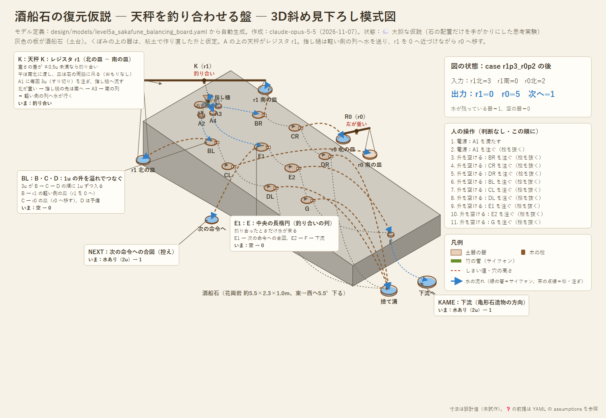

# 設計09：酒船石の復元仮説 ― 天秤を釣り合わせる盤

- 作成：Claude Opus 5.5（`claude-opus-5-5`）、2026-11-07
- 方針：kuippa。チューリング機械だったと**仮定して**、必要な構成を復元する。欠損部の既存の復元（村上ら2017 の左右対称の補い）は使わない。失われた部分は粘土など柔らかいもので作られていたと仮に置いてよい。石は土台で、上を粘土で覆っていた可能性も認める。容積は実測に合わせなくてよい
- 状態：💭 **大胆な仮説（思考実験）**。石の配置に合うように組んだもので、証拠ではない
- モデル定義：[models/level5a_sakafune_balancing_board.yaml](models/level5a_sakafune_balancing_board.yaml)（5通り照合済み）

---

## 1. 石から使うもの・使わないもの

| 使うもの | 状態 |
|---|---|
| くぼみの**並び方とつながり方**：東端に A1、その下に A2（北）・A4（中央）・A3（南）。北と南に3つずつのくぼみ（B・C・D）が斜めの溝に沿って並ぶ。中央に長楕円の E（E1・E2）、西端に出口 F、片側に G | 村上ら2017 の模式図（呼び方も村上ら） |
| 東から西へ約5.5度下る傾き | ✅ 日経2014 |
| 東の高い所に導水の遺構（土管・石樋、石の東約40m） | ✅ 村上ら2017 |
| 丘の下に導水施設（亀形石造物） | ✅ 日経2014・村上ら2017 |

| 使わないもの | 理由 |
|---|---|
| くぼみの容積・深さ | 粘土の縁で作り直されていたと仮定する |
| 北・南の欠損部 | 後世に割られたもの。既存の復元も使わない |

## 2. 復元の構成（4つの層）

| 層 | 素材 | 中身 |
|---|---|---|
| 0. 土台 | 石（現存） | くぼみと溝の配置。東→西の傾きで水を流す |
| 1. 粘土（失われた） | 粘土・漆喰 | くぼみの上に盛った**すり切りの縁**（どれも 1u、A1 だけ 3u）。くぼみの間の**堰と注ぎ口**（B → C → D の順に溢れる）。くぼみから石の脇へ出す注ぎ口 |
| 2. 木と竹（失われた） | 木・竹・縄 | A の上に**南北に渡した天秤 K**（皿は石の北と南の脇に吊る）、支点の下の**指し樋**。石の脇に置く別の天秤（レジスタ r0） |
| 3. 水 | ― | 東の導水から A1 へ（電源）。F から西へ、丘の下の施設へ（終わりの合図） |

## 3. 仕組み

### 天秤 K ＝ レジスタ r1
- 値 r1 ＝ 北の皿の水 − 南の皿の水（設計07 と同じく、水は足すだけ）。
- **おもりは置かない**。釣り合いの幅は ±0.5u（設計05 と同じ）。r1 > 0 なら北が重く、r1 = 0 なら釣り合い、r1 < 0 なら南が重い。
- 天秤のいちばん自然な状態（釣り合い）が「0」になる。

### 指し樋は「軽い側」へ水を送る
- 指し樋は支点の下に垂れているので、北が下がると、先は南へ振れる。
- そのため、A1 から注いだ水は、**軽い側の列**へ流れる：北が重ければ A3 → 南の列、南が重ければ A2 → 北の列、釣り合えば A4 → 中央の列。

### 各列の3つのくぼみ ＝ 1u の升を溢れでつないだもの
- A1 の 3u が、B → C → D の順に 1u ずつ入る（すり切りの升なので、分水口より正確。設計06 §3）。
- 南の列（r1 > 0 のとき）：
  - **BR → 南の皿**：軽い側に 1u 足す。r1 が 1 減る。**人が天秤を釣り合わせるときの手つき**そのもの（負のフィードバック）
  - **CR → r0 の北の皿**：r0 が 1 増える
  - DR：予備（もう1つのレジスタへの写しなどに使える）
- 北の列（r1 < 0 のとき）：BL → 北の皿（r1 が 1 増える）、CL → r0 の南の皿（r0 が 1 減る）、DL は予備
- 中央の列（r1 = 0 のとき）：E1 → 「次の命令へ」の合図、E2 → F → 下流へ、G は予備

### 1回の手順（毎回同じ。判断なし）
1. A1 を満たして注ぐ（3u）
2. 全部のくぼみの注ぎ口を開ける

### 結果
- r1 が 0 になるまで、1回ごとに r1 を 1 ずつ r0 へ移す（**r0 += r1、r1 は 0 に**。符号つきで働く）。
- 釣り合ったら、水は中央の列だけに流れ、**F から下流へ水が出る**。それが終わりの合図になる。その後は何回くり返しても状態は変わらない（自然に止まる）。

### 照合（YAML のモデル、5通り）
| 場合 | 結果 |
|---|---|
| r1 = 3、r0 = 2（5回） | r1 = 0、r0 = 5、次へ・下流に水 |
| r1 = −2、r0 = 1（4回） | r1 = 0、r0 = −1 |
| r1 = 0、r0 = 4（1回） | すぐに次へ |
| r1 = 3（2回で打ち切り） | r1 = 1、r0 = 2、次へはまだ |
| 皿に水が多く溜まった状態（北7・南4 で r1 = 3） | r1 = 0、r0 = 3（差だけで決まる） |

## 4. チューリング機械としての位置づけ 💭

- この盤が実行するのは、カウンタ機械の「JZDEC のループ」を1つにまとめた命令：**「r1 が 0 でなければ 1 つ r0 へ移して繰り返す。0 なら次へ」**。分岐（0 かどうか）、減算、加算、繰り返しが1枚に入っている。
- 予備のくぼみ（DR・DL・G）を別のレジスタへつなげば、「r1 を r0 と r2 の両方へ写す」もできる。掛け算に必要な「写して戻す」が作れる。
- 任意のプログラムを動かすには、命令を順番に並べる仕組み（設計07 の駅と手番の水）が要る。考えられる形は2つ：
  - **(a) 盤を何枚も使う**：命令ごとに1枚。E1 の「次へ」の水を、次の盤の手番にする
  - **(b) 1枚の盤をつなぎ替える**：粘土の注ぎ口の行き先を変える（プログラムを粘土で書く）。ただし、つなぎ替えを人が状態を見て行うなら、それは「判断」になる。決まった順につなぎ替えるだけなら判断ではない
- 飛鳥のほかの石造物（出水の酒船石など）を、別の命令の盤とみなす読み方もありうる。ただし、今は根拠がない。❓

## 5. この読み方の良い点と弱い点

**良い点**（配置と働きが自然に合う）
- 中央の軸（A4 → E → F）が「釣り合い ＝ 0」の道になり、そのまま西の出口と丘の下へつながる。
- 北と南の列が左右対称なのは、符号（＋と−）の対称として説明できる。
- 各列にくぼみが3つあるのは、1回の判定を3か所へ写す（設計06 で必要だったファンアウト）として説明できる。
- 東が高く西が低い傾きは、東の電源の水から西の出口への流れに合う。導水の遺構が東の高い所にあることとも合う。
- 天秤を釣り合わせる動作が、そのまま計算になる。

**弱い点・説明できていない点**
- 粘土の縁・堰・注ぎ口や、天秤・支柱は残っておらず、直接の証拠がない。
- E は1つの長楕円のくぼみで、E1 と E2 は分かれていない（粘土の仕切りを仮定している）。
- G が片側にしかない理由が、この読み方では説明できない（予備の升とした）。
- くぼみから石の北と南の脇へ水を出す道は、石には彫られていない（竹の樋か粘土の注ぎ口を仮定している）。
- 祭祀・庭園の施設としても、同じ配置は説明できる（設計08）。

## 6. 確かめられること（この仮説が正しければ見つかるはず）

| 観点 | 何を見るか |
|---|---|
| 支柱の跡 | 石の東端の北と南の地面に、天秤の支柱を立てた穴があるか（発掘調査の記録） |
| 粘土・漆喰の痕跡 | くぼみの縁や溝の中に、付着物や縁を盛った跡（表面の色・荒れ方の違い）があるか |
| くぼみの縁の加工 | 縁の一部だけ低い（注ぎ口の）ところがあるか |
| A1 と A2〜A4 の関係 | A1 から A2〜A4 へ、直接つながる溝があるか（あれば分水口、なければ受け口の読み方に有利） |
| 石の脇の加工 | 北と南の側面の、B・C・D の近くに、樋を掛けた跡があるか（欠損していない部分で） |
