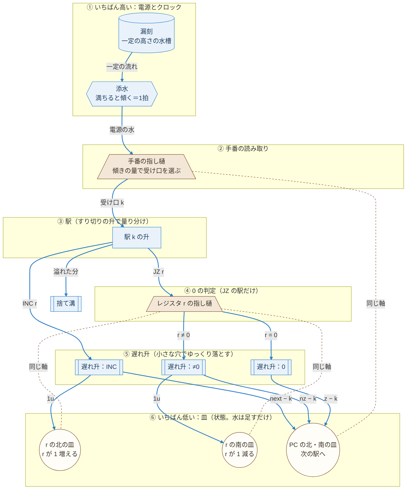
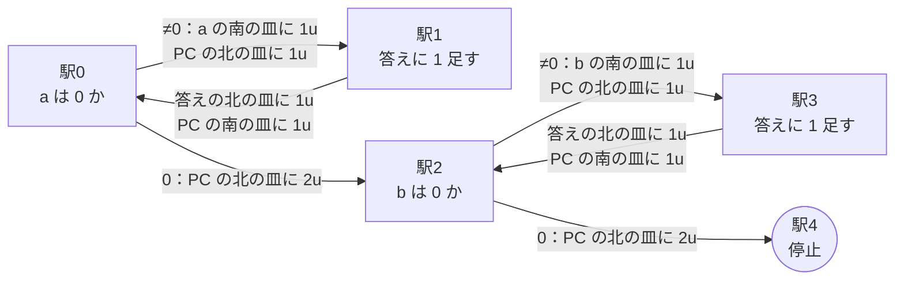

# 設計10：フォールモデル ― 位置エネルギーだけで計算する

- 作成：Claude Opus 5.5（`claude-opus-5-5`）、2026-11-08
- 方針：kuippa。最初に水を置いたら、あとは位置エネルギーだけで、水は上から下へだけ流れる。酒船石とは切り離した、別のモデルとして作る（設計09は、石に合わせるために水を上へ運ぶ必要が出ていた）
- 状態：💭 設計スケッチ。論理はシミュレーションで照合済み
- 計算の中身：[tools/viewer/fall_machine.js](../tools/viewer/fall_machine.js)、テスト：`node tools/viewer/test_fall.js`、画面：`node tools/viewer/serve.js` → http://localhost:8765/fall.html

---

## 1. 考え方

- 水は戻れないので、「手番の水が駅から駅へ移る」方式（設計07・09）では輪（くり返し）が作れない。
- そこで、**状態をすべて「いちばん下の皿に足すだけの水」で持つ**。値 ＝ 北の皿 − 南の皿（設計07 と同じ）。
- いまの命令（プログラムカウンタ PC）も天秤1本で持つ。前の駅へ戻るときは南の皿に足すので、水は下へ流れるだけでよい。
- 人の手は、最初に「水槽を満たす」「入力の皿に a・b の数だけ水を入れる」だけ。

## 2. 高さの順（上から下へしか流れない）

| 高さ | 部品 | 働き |
|---|---|---|
| いちばん上 | 漏刻（一定の高さの水槽） | 一定の速さで水を流す。飛鳥の漏刻（660年）と同じ仕組み ✅ |
| | 添水（鹿威し） | 満ちるたびに傾いて、電源の水をまとめて落とす ＝ **クロック**（拍） 🔍 |
| | 手番の指し樋 | PC の天秤と**同じ軸**。傾きの量で、駅0・駅1・… の受け口のどれかへ水を落とす（目盛りを読む天秤） 💭 |
| | 駅の升 | すり切りで量り分ける（1u と、PC を動かす分）。余りは溢れて捨て溝へ |
| | 0 の判定の指し樋 | JZ の駅だけ。レジスタの天秤と同じ軸。0 か、0 でないかで列を選ぶ |
| | 遅れ升 | 小さな穴でゆっくり落とす。電源の水が通り終わってから皿の水が増えるようにする（途中で竿が動いて行き先が変わるのを防ぐ） 💭 |
| いちばん下 | 皿（レジスタと PC） | 水が溜まるだけ。値 ＝ 北 − 南 |

## 3. 命令

Minsky のカウンタ機械と同じ3つ。
- **INC r → next**：r の北の皿に 1u、PC を next − k だけ動かす（北か南の皿に |next − k| u）
- **JZ r → z / nz**：r が 0 なら PC を z へ。0 でなければ r の南の皿に 1u（1 減らす）、PC を nz へ
- **HALT**：PC が止まりの駅を指すと、添水の水は捨て溝へ流れるだけになる（自然に止まる）

## 4. 結果（四則演算）

a, b = 0〜9 の全組み合わせで正しい（割り算は b = 1〜9。b = 0 は止まらない）。

| 演算 | 駅 | 1拍の水 | 最大の拍 | 水槽から使う水（最大） | 皿の最大 |
|---|---|---|---|---|---|
| 足し算 | 5 | 3u | 38 | 114u | 22u |
| 引き算 | 4 | 4u | 28 | 112u | 21u |
| 掛け算 | 7 | 7u | 433 | 3031u | 285u |
| 割り算 | 9 | 8u | 105 | 840u | 108u |

升の精度（a = 7, b = 3、各200回）：
| 演算 | ±0.5% | ±1% | ±3% | ±5% |
|---|---|---|---|---|
| 足し算 | 100% | 100% | 100% | 93% |
| 引き算 | 100% | 100% | 100% | 99% |
| 掛け算 | 100% | 100% | 33% | 6% |
| 割り算 | 100% | 100% | 55% | 17% |

設計09（±3% で掛け算 98%）より誤差に弱い。PC の皿にも毎拍水が溜まり、その誤差も積み重なるため。長い計算には ±1% の升が要る。

## 5. 限界と課題（❓）

- 水槽の水を使い切れば止まる。皿には水が溜まり続ける。計算できる長さは、水槽と皿の大きさで決まる。
- 目盛りを読む天秤（PC）は、駅の数だけ受け口を見分ける必要がある（割り算で9つ）。受け口の位置は、組み立てた後に PC に 0, 1, 2… の水を入れて印をつける（校正）想定。
- 遅れ升の遅れが、電源の水が通る時間より長く、拍の間隔より短いこと。
- 添水が落とす量は毎回少しずつ違ってよい（駅の升がすり切りで量り直す）。足りないことだけは避ける。

## 6. 模式図（Mermaid）

### 6.1 装置の全体（どのプログラムでも同じ）

上から下へ、高さの順に並べている。**青い実線は水の流れ**で、必ず上から下へ向かう。**茶色の点線は「同じ軸」**（天秤の竿の傾きを、上にある指し樋へ伝える木の軸）で、水は流れない。

### 6.2 プログラムの流れ（足し算 a + b）

**矢印は手番（PC）の移り変わりで、水の流れではない。** 手番が「戻る」矢印も、水は上へ戻らない（PC の南の皿に水を足して、値を小さくするだけ）。

