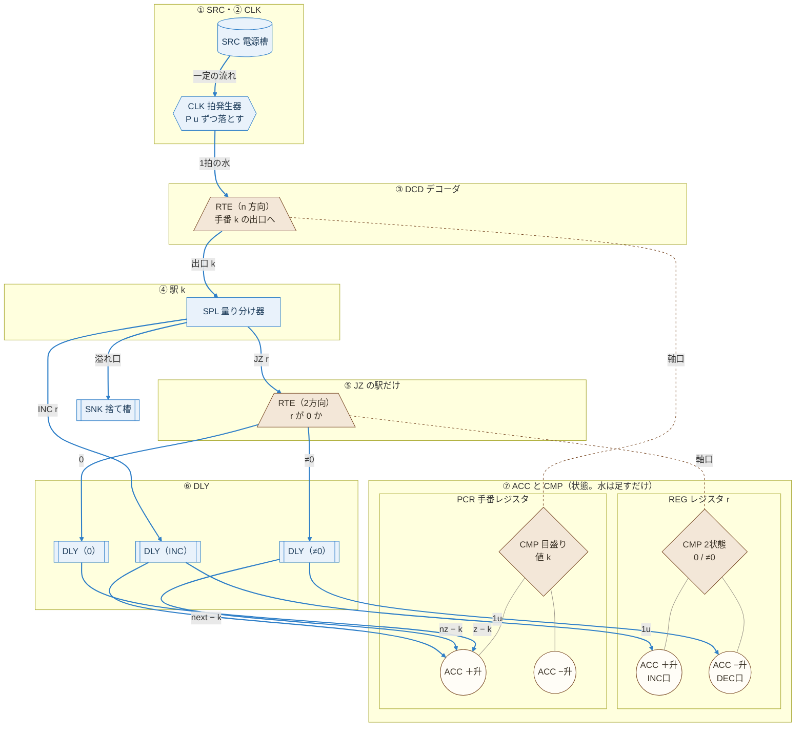
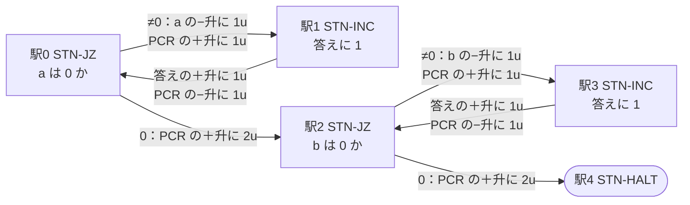

# 設計10：フォールモデル ― 位置エネルギーだけで計算する

- 作成：Claude Opus 5.5（`claude-opus-5-5`）、2026-11-08
- 方針：kuippa。最初に水を置いたら、あとは位置エネルギーだけで、水は上から下へだけ流れる。酒船石とは切り離した、別のモデルとして作る（設計09は、石に合わせるために水を上へ運ぶ必要が出ていた）
- 状態：💭 設計スケッチ。論理はシミュレーションで照合済み
- 部品：[parts_catalog.md](parts_catalog.md) の機能部品（SRC・CLK・SPL・DLY・ACC・CMP・RTE、組み合わせの REG・PCR・DCD・駅）で書く
- 計算の中身：[tools/viewer/fall_machine.js](../tools/viewer/fall_machine.js)、テスト：`node tools/viewer/test_fall.js`、画面：`node tools/viewer/serve.js` → http://localhost:8765/fall.html

---

## 1. 考え方

- 水は戻れないので、「手番の水が駅から駅へ移る」方式（設計07・09）では輪（くり返し）が作れない。
- そこで、**状態をすべて「いちばん下の蓄積升（ACC）に足すだけの水」で持つ**。レジスタ（REG）の値 ＝ ＋升 − −升（設計07 と同じ）。
- いまの命令の番号も、手番レジスタ（PCR）に持つ。前の駅へ戻るときは−升に足すので、水は下へ流れるだけでよい。
- 人の手は、最初に「電源槽（SRC）を満たす」「入力のレジスタの＋升に a・b の数だけ水を入れる」だけ。

## 2. 部品と高さの順（上から下へしか流れない）

| 高さ | 部品 | この装置での働き |
|---|---|---|
| ① いちばん上 | **SRC** 電源槽 | 一定の速さで水を流す（実体：漏刻の水槽 ✅） |
| ② | **CLK** 拍発生器 | P u たまるたびにまとめて落とす ＝ 1拍（実体：添水 🔍） |
| ③ | **DCD** デコーダ（PCR の軸口 ＋ RTE） | 手番レジスタの値 k で、出口 k（駅 k）を選ぶ 💭 |
| ④ | **駅**（SPL 量り分け器） | 拍の水を、決まった量に分ける。残りは溢れ口から捨て槽（SNK）へ |
| ⑤ | **RTE** 振り分け器（JZ の駅だけ） | レジスタ r の軸口の状態（0 / ≠0）で出口を選ぶ |
| ⑥ | **DLY** 遅延升 | ゆっくり落とす。拍の水が振り分け器を通り終わってから、蓄積升の水が増えるようにする 💭 |
| ⑦ いちばん下 | **ACC** 蓄積升（REG・PCR の＋升・−升） | 水が溜まるだけ。比較器（CMP）がその重さを比べ、状態を軸口で上の振り分け器へ伝える |

## 3. 命令（駅）

Minsky のカウンタ機械と同じ3つ。
- **STN-INC r → next**：1u を r の INC口（＋升）へ。\|next − k\| u を PCR の＋升（進む）か−升（戻る）へ
- **STN-JZ r → z / nz**：r が 0 なら \|z − k\| u を PCR へ。0 でなければ 1u を r の DEC口（−升）へ、\|nz − k\| u を PCR へ
- **STN-HALT**：入った水は捨て槽へ。PCR は変わらないので、自然に止まる

## 4. 結果（四則演算）

a, b = 0〜9 の全組み合わせで正しい（割り算は b = 1〜9。b = 0 は止まらない）。

| 演算 | 駅 | 1拍の水 P | 最大の拍 | 電源槽から使う水（最大） | 蓄積升の最大 |
|---|---|---|---|---|---|
| 足し算 | 5 | 3u | 38 | 114u | 22u |
| 引き算 | 4 | 4u | 28 | 112u | 21u |
| 掛け算 | 7 | 7u | 433 | 3031u | 285u |
| 割り算 | 9 | 8u | 105 | 840u | 108u |

定量升・量り分け器の精度（a = 7, b = 3、各200回）：
| 演算 | ±0.5% | ±1% | ±3% | ±5% |
|---|---|---|---|---|
| 足し算 | 100% | 100% | 100% | 93% |
| 引き算 | 100% | 100% | 100% | 99% |
| 掛け算 | 100% | 100% | 33% | 6% |
| 割り算 | 100% | 100% | 55% | 17% |

設計09（±3% で掛け算 98%）より誤差に弱い。手番レジスタの蓄積升にも毎拍水が溜まり、その誤差も積み重なるため。長い計算には ±1% の量り分け器が要る。

### 4.1 止まらない計算とあふれ止め

割り算で b ＝ 0 にすると、「0 を引く」をくり返して止まらない（想定どおり）。そこで、手番レジスタ（PCR）の−升に容量をつけ、あふれたら異常停止にする（[parts_catalog.md](parts_catalog.md) の「あふれ止め」）。

| 条件 | 結果 |
|---|---|
| 1 ÷ 0、5 ÷ 0、−升の容量なし | 止まらない（20000 拍で打ち切り） |
| 同じく、容量 400u | 232 拍で**異常停止**（あふれ 6u。答えは無効） |
| 同じく、容量 100u | 60 拍で異常停止 |
| ふつうの四則演算（a, b ≤ 9）、容量 400u | −升の最大 279u。あふれは 0 件 |

容量は「計算の長さの上限」でもある。入力を大きくすると、正しい計算でも−升があふれて異常停止になるので、容量を大きくする（画面のスライダー「PCR −升の容量」）。

## 5. 限界と課題（❓）

- 電源槽の水を使い切れば止まる。蓄積升には水が溜まり続ける。計算できる長さは、電源槽と蓄積升の大きさで決まる。
- デコーダは、駅の数だけ出口を見分ける必要がある（割り算で9つ）。出口の位置は、組み立てた後に手番レジスタへ 0, 1, 2… の水を入れて印をつける（校正）想定。
- 遅延升の遅れが、拍の水が通る時間より長く、拍の間隔より短いこと。
- 拍発生器が落とす量は毎回少しずつ違ってよい（量り分け器が量り直す）。足りないことだけは避ける。

## 6. 模式図（Mermaid）

### 6.1 装置の全体（どのプログラムでも同じ）

部品は [parts_catalog.md](parts_catalog.md) の記号で書く。上から下へ、高さの順に並べている。**青い実線は水路（PIPE）**で、必ず上から下へ向かう。**茶色の点線は軸口**（比較器の状態を、上の振り分け器へ伝える）で、水は流れない。

- ⑦ の灰色の細い線は「蓄積升を比較器の竿に吊るしている」（重さが比較器にかかる）ことを表す。
- 「next − k」が負のときは、PCR の−升へ \|next − k\| u（図では省略）。

### 6.2 プログラムの流れ（足し算 a + b）

**矢印は手番（PCR の値）の移り変わりで、水の流れではない。** 手番が「戻る」矢印も、水は上へ戻らない（PCR の−升に水を足して、値を小さくするだけ）。

## 7. 部品表（足し算 a + b）

| 部品 | 数 | 決める値 | 備考 |
|---|---|---|---|
| SRC 電源槽 | 1 | 114u 以上（a, b ≤ 9） | 最初に満たす |
| CLK 拍発生器 | 1 | P ＝ 3u | |
| DCD デコーダ | 1 | 5方向 | PCR の軸口につなぐ |
| PCR 手番レジスタ | 1 | 目盛り 0〜4 | 最初は 0（空） |
| REG レジスタ | 3 | a、b、答え | a・b の＋升に入力の水を入れておく |
| 駅 STN-JZ | 2 | 駅0（a）、駅2（b） | RTE ×1、SPL ×2（≠0：1u＋1u、0：2u） |
| 駅 STN-INC | 2 | 駅1、駅3 | SPL（1u＋1u） |
| 駅 STN-HALT | 1 | 駅4 | |
| DLY 遅延升 | 駅ごと | τ ＜ 拍の間隔 | 蓄積升の手前に必ず入れる |
| SNK 捨て槽 | 1 | 電源槽と同じくらい | 溢れ口・停止の駅から |
