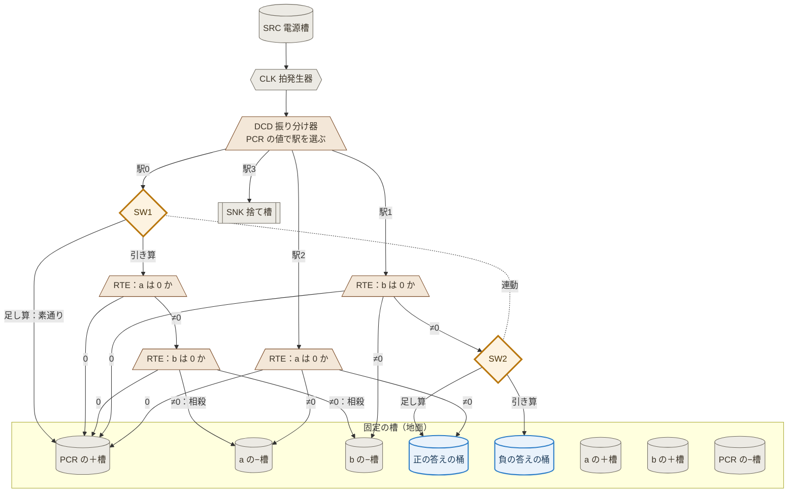

# 設計11：v2 草案 ― 足し算と引き算を、同じ固定した装置で回す

- 作成：Claude Opus 5.5（`claude-opus-5-5`）、2026-11-08
- 方針：kuippa。v2 は「共通の回路」。でき上がるものは水を受け渡す重い装置になるので、**桶は固定して動かさない**。まず足し算と減算で、動かないもの（共通化できるもの）と、切り替えだけで済むものを分ける（最小公倍数的な構成）
- 状態：💭 草案（v2 開発中）。論理はシミュレーションで照合済み。**第2版**（第1版の誤りは §0）
- 親：[v1.0](../VERSIONS.md)（設計10 フォールモデル）
- 計算の中身：[tools/v2/addsub_machine.js](../tools/v2/addsub_machine.js)、テスト：`node tools/v2/test_addsub.js`
- 画面：`node tools/viewer/serve.js` → http://localhost:8765/v2/fall_v2.html（固定の槽、浮き比較器、連動した切り替え器。1拍を4段階で見る）

---

## 0. 第1版の誤り（記録）

第1版では、レジスタが負の数を持てることを使い、足し算と引き算を「b が 0 になるまで、b から 1 取って a の＋槽（足し算）／−槽（引き算）へ」とした（駅2つ、切り替え器1つ）。

**kuippa の指摘**：引き算 3 − 4 は、a に「＋槽 3u・−槽 4u」が溜まるだけで、実質なんの計算もしていない。答えの −1 は、読む人が2つの槽の差を取って初めて分かる。浮き比較器が分かるのも符号（0 か、どちらが多いか）までで、差の大きさは出せない。

→ 第2版では、**答えを「1つの桶に、答えの量だけ」出す**ことを決まりにした。なお、同じ弱点は v1 の引き算にもあった（7 − 3 の答え 4 は「a の＋槽 7u・−槽 3u」の差として残っていた）。

## 1. 考え方：相殺して、残りを答えの桶へ移す

- 引き算 a − b：**a と b がどちらも 0 でない間、両方から 1 ずつ取る（相殺）**。どちらかが 0 になったら、残ったほうを答えの桶へ移す。a が残れば「正の答え」の桶、b が残れば「負の答え」の桶。
- 足し算 a + b：相殺はせず、b と a を両方「正の答え」の桶へ移す。
- どちらも、**答えは2つの答えの桶のどちらか一方だけに、答えの大きさの水として入る**。読む人は引き算をせず、量とどちらの桶かを読むだけ。

| 駅 | 足し算 | 引き算 |
|---|---|---|
| 0：相殺 | 素通り（SW1）→ 駅1 | a ＝ 0 → 駅1。b ＝ 0 → 駅2。どちらも ≠0 → a の−槽・b の−槽へ 1u ずつ（駅0 をくり返す） |
| 1：b → 答え | b ≠ 0：b の−槽へ 1u、正の答えの桶へ 1u（SW2）。b ＝ 0 → 駅2 | 同じ。ただし答えは**負の答えの桶**へ（SW2） |
| 2：a → 答え | a ≠ 0：a の−槽へ 1u、正の答えの桶へ 1u。a ＝ 0 → 駅3 | 同じ |
| 3：停止 | 拍の水は捨て槽へ | 同じ |

- 駅0 の相殺は、振り分け器を2段つなぐ（a は 0 か → b は 0 か）。1拍の中で2つのレジスタを見る。
- 切り替え器は2か所（駅0 の入口 SW1、駅1 の出口 SW2）あるが、**1本のレバーで連動**させる。スタート前に倒し、計算中は動かさない。
- 計算が終わると、a・b のレジスタは 0（＋槽と−槽が同じ量）に戻る。水は足すだけなので、槽には水が残る。

## 2. 桶を動かさない：浮き比較器

v1 の比較器（CMP）は天秤で、蓄積升（皿）を竿に吊っていた。水が増えると皿が重くなり、竿と支点も重い作りが要る。

v2 では、**槽は地面に固定し、水位を浮きで読む**。
- 比べる2つの槽（＋槽・−槽）に、それぞれ浮きを浮かべる。2つの槽は同じ断面にする（水位 ∝ 水の量）
- 2つの浮きの上に、軽い竿を渡す。竿は水位の差で傾く ＝ 値（＋槽 − −槽）が 0 か、0 でないかが分かる
- 竿の傾きを、軸口で振り分け器へ伝える。1つの竿に振り分け器をいくつつないでもよい（a の竿は駅0 と駅2、b の竿は駅0 と駅1 の振り分け器を動かす）
- 動くのは浮き・竿・振り分け器の樋だけで、どれも軽い。水の重さは、固定した槽が受ける

浮きで水位を読むのは、漏刻の「浮箭（ふせん）」と同じ使い方。📘（漏刻の浮箭は文献で知られる。飛鳥の漏刻の細部は ❓）

## 3. 固定・軽い可動部・切り替え

| 区分 | 部品 | 足し算と引き算で |
|---|---|---|
| **固定（動かない）** | SRC 電源槽、CLK 拍発生器の受け台、DCD の受け口、駅0〜2 の量り分け器、遅延升、a・b・PCR の＋槽と−槽、**答えの桶2つ**（正・負）、SNK 捨て槽、水路 | 共通 |
| **軽い可動部** | 浮き・竿（a・b・PCR の浮き比較器）、振り分け器の樋（DCD、駅0 の2段、駅1、駅2）、添水 | 共通 |
| **切り替え（スタート前に決める）** | **レバー1本**（SW1：駅0 を素通りか相殺か、SW2：駅1 の水を正の桶か負の桶か） | **ここだけ違う** |
| **入力（スタート前に置く水）** | a の＋槽に a u、b の＋槽に b u、電源槽を満たす | 値が違うだけ |

灰色＝固定、茶色＝軽い可動部、橙の太枠＝切り替え（ここだけが足し算と引き算で違う）、青＝答えの桶。浮き比較器と軸口、遅延升、PCR を進める水の量（駅0 で b ＝ 0 のときは 2u）は省略。

## 4. 結果

| 条件 | 足し算 | 引き算 |
|---|---|---|
| 誤差なし、a, b = 0〜9 の全組み合わせ（答えが片方の桶だけに入ることも確認） | 100/100 | 100/100 |
| 例 | 3 + 4 → 正の桶 7u | 3 − 4 → **負の桶 1u**／7 − 3 → 正の桶 4u |
| 最大の拍 | 21 | 12 |
| 電源の水（最大） | 63u | 36u |
| 定量升の精度 ±3% | 100% | 100% |
| ±5% | 99% | 100% |
| ±10% | 65% | 89% |

第1版（最大10拍）より拍は増えた（足し算は a と b を両方答えの桶へ移すため）。それでも v1（足し算 最大38拍）より少ない。

## 5. 決めたいこと（❓）

1. **比較器は浮き式でよいか**。天秤式（v1）より桶を固定しやすいが、槽の断面をそろえる必要がある
2. **入力の a・b を残すか**。今は答えの桶へ移すので、a・b のレジスタは 0 になる（水は槽に残る）。入力を残したい場合は、移すときに写しも作る（振り分け器で 1u をもう1本）
3. **答えの読み方**。今は答えの桶の水の量を人が読む。将来、栓を抜いて 1u ずつ流し、添水で数える仕組み（kuippa の案、先送り）

## 6. 次（掛け算・割り算へ広げる見通し）

- 掛け算・割り算は「くり返しの入れ子」と「写して戻す」が要るので、駅が増える。共通化の考え方は同じで、**固定する駅の並び**を決め、**切り替え器で素通り・行き先を選ぶ**形を目指す
- 今回の「相殺」「移す」「素通り」は、掛け算・割り算でも使える部品になる見込み
