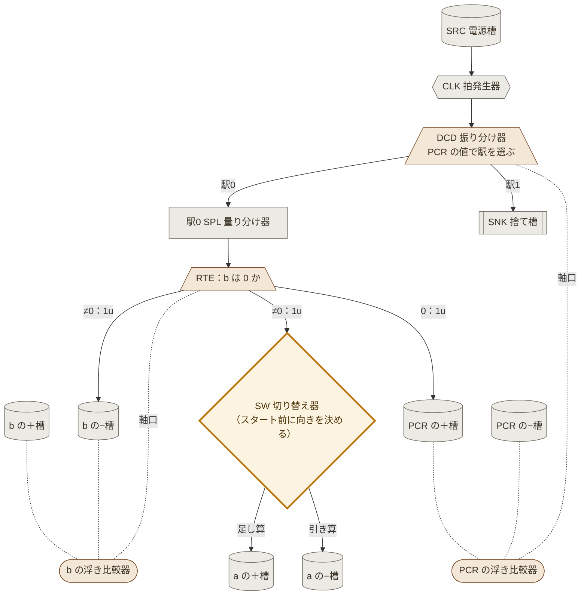

# 設計11：v2 草案 ― 足し算と引き算を、同じ固定した装置で回す

- 作成：Claude Opus 5.5（`claude-opus-5-5`）、2026-11-08
- 方針：kuippa。v2 は「共通の回路」。でき上がるものは水を受け渡す重い装置になるので、**桶は固定して動かさない**。まず足し算と減算で、動かないもの（共通化できるもの）と、切り替えだけで済むものを分ける（最小公倍数的な構成）
- 状態：💭 草案（v2 開発中）。論理はシミュレーションで照合済み
- 親：[v1.0](../VERSIONS.md)（設計10 フォールモデル）
- 計算の中身：[tools/v2/addsub_machine.js](../tools/v2/addsub_machine.js)、テスト：`node tools/v2/test_addsub.js`

---

## 1. 気づいたこと：足し算と引き算は同じプログラムになる

v1 では、足し算（駅5つ）と引き算（駅4つ）でプログラムも配線も違った。しかしレジスタは「＋槽 − −槽」なので、負の数も持てる。すると、

- 足し算 a + b ＝ b が 0 になるまで、b から 1 取って、**a の＋槽**に 1 足す
- 引き算 a − b ＝ b が 0 になるまで、b から 1 取って、**a の−槽**に 1 足す

で、**違いは「a のどちらの槽へ入れるか」だけ**になる。プログラムは共通で、駅は2つしか要らない。

| 駅 | 命令 | 動き |
|---|---|---|
| 0 | STEP b → a | b ≠ 0：b の−槽へ 1u（b が 1 減る）、1u を切り替え器へ。手番はそのまま（駅0 をくり返す） b ＝ 0：PCR の＋槽へ 1u（駅1 へ） |
| 1 | 停止 | 拍の水は捨て槽へ |

STEP は「JZ と転送を1つにまとめた命令」（設計09 の盤と同じ考え方を、フォールモデルで作り直したもの）。

## 2. 桶を動かさない：浮き比較器

v1 の比較器（CMP）は天秤で、蓄積升（皿）を竿に吊っていた。水が増えると皿が重くなり、竿と支点も重い作りが要る。

v2 では、**槽は地面に固定し、水位を浮きで読む**。
- 比べる2つの槽（＋槽・−槽）に、それぞれ浮きを浮かべる。2つの槽は同じ断面にする（水位 ∝ 水の量）
- 2つの浮きの上に、軽い竿を渡す。竿は水位の差で傾く ＝ 値（＋槽 − −槽）の符号が分かる
- 竿の傾きを、軸口で振り分け器へ伝える（v1 と同じ）
- 動くのは浮き・竿・振り分け器の樋だけで、どれも軽い。水の重さは、固定した槽が受ける

浮きで水位を読むのは、漏刻の「浮箭（ふせん）」と同じ使い方。📘（漏刻の浮箭は文献で知られる。飛鳥の漏刻の細部は ❓）

## 3. 固定・軽い可動部・切り替え

| 区分 | 部品 | 足し算と引き算で |
|---|---|---|
| **固定（動かない）** | SRC 電源槽、CLK 拍発生器（の受け台）、DCD の受け口、駅0 の量り分け器、遅延升、**a の＋槽・−槽**、**b の＋槽・−槽**、PCR の＋槽・−槽、SNK 捨て槽、水路 | 共通 |
| **軽い可動部** | 浮き・竿（b と PCR の浮き比較器）、振り分け器の樋（DCD、駅0）、添水 | 共通 |
| **切り替え（スタート前に手で決める）** | **SW 切り替え器 1つ**：駅0 の「a へ」の 1u を、a の＋槽へ流すか（足し算）、−槽へ流すか（引き算） | **ここだけ違う** |
| **入力（スタート前に置く水）** | a の＋槽に a u、b の＋槽に b u、電源槽を満たす | 値が違うだけ |

- a は「0 か」を読まれないので、浮き比較器は要らない（出力：2つの桶。値 ＝ ＋槽 − −槽）。答えが負なら−槽のほうが多い
- 切り替え器はスタート前に向きを決め、計算中は動かさない（「最初に水を置いたら、あとは位置エネルギーだけ」の決まりを守る）

灰色＝固定、茶色＝軽い可動部、橙の太枠＝切り替え（ここだけが足し算と引き算で違う）。遅延升は省略（各槽の手前に入る）。

## 4. 結果

| 条件 | 足し算 | 引き算 |
|---|---|---|
| 誤差なし、a, b = 0〜9 の全組み合わせ | 100/100 | 100/100（負の答えも：例 2 − 7 ＝ −5） |
| 最大の拍 | 10 | 10 |
| 電源の水（最大） | 30u | 30u |
| 定量升の精度 ±3% | 100% | 100% |
| ±5% | 99% | 100% |
| ±10% | 81% | 83% |

v1（足し算 最大38拍、±5% で 93%）より、拍も少なく、誤差にも強い。拍が少ないので、誤差が溜まりにくい。

## 5. 決めたいこと（❓）

1. **比較器は浮き式でよいか**。天秤式（v1）より桶を固定しやすいが、槽の断面をそろえる必要がある
2. **答えを a に入れてよいか**。この形では a が答えに置き換わる（入力の a は残らない）。a を残したい場合は、答え用の出力桶を別に用意し、転送を2本（a へ・答えへ）にする
3. **負の答えの読み方**。今は「a の＋槽と−槽の差」を人が読む。浮き比較器を a にもつければ、符号を指し示せる

## 6. 次（掛け算・割り算へ広げる見通し）

- 掛け算・割り算は「くり返しの入れ子」と「写して戻す」が要るので、駅が増える。共通化の考え方は同じで、**固定する駅の並び**を決め、**切り替え器で転送先・行き先を選ぶ**形を目指す
- 四則演算を1つの装置で回すには、駅の数を四則演算の最大（割り算）に合わせ、使わない駅は切り替え器で飛ばす、という形が候補
